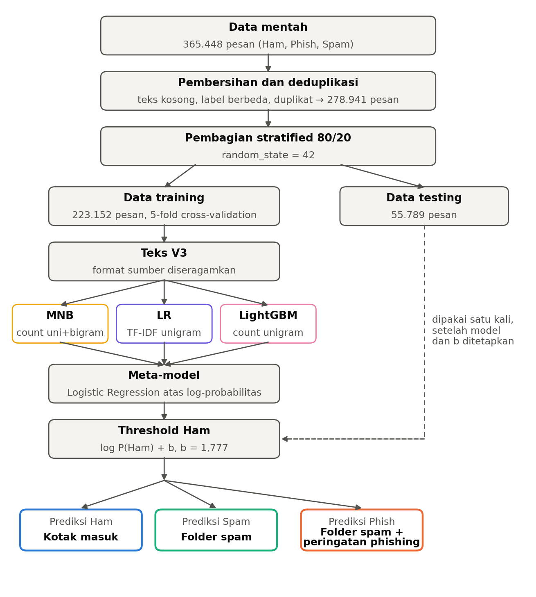
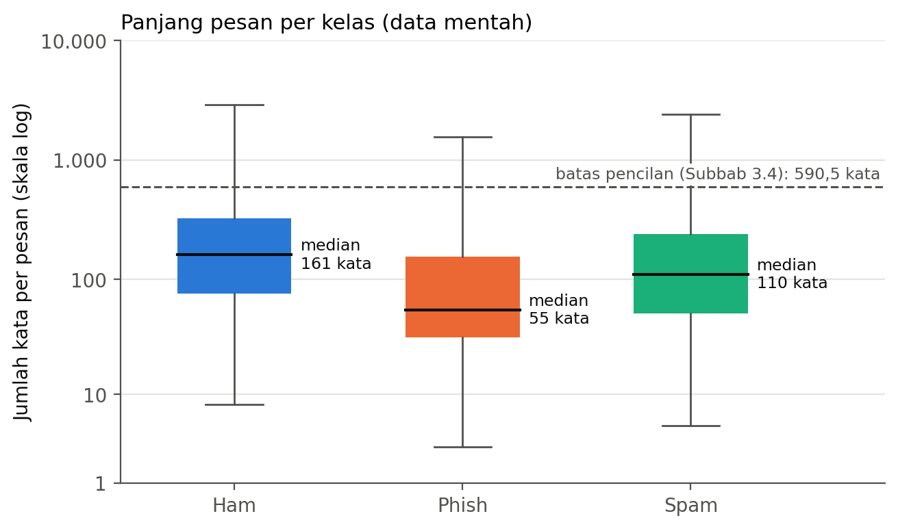
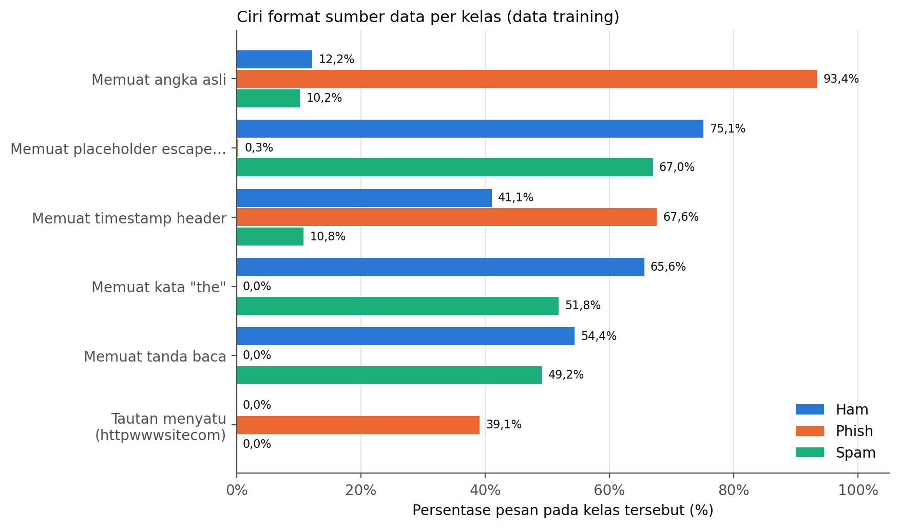
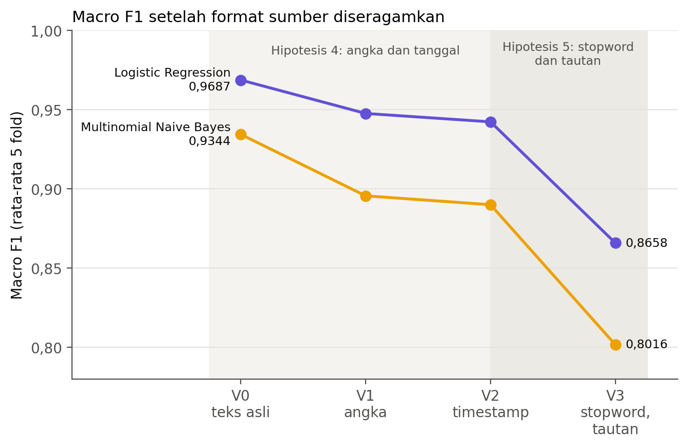
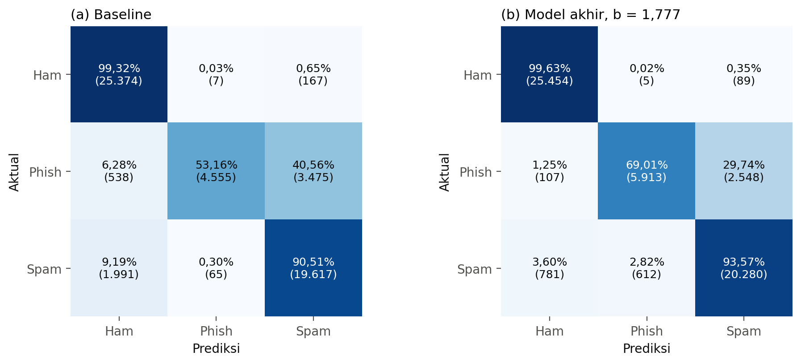
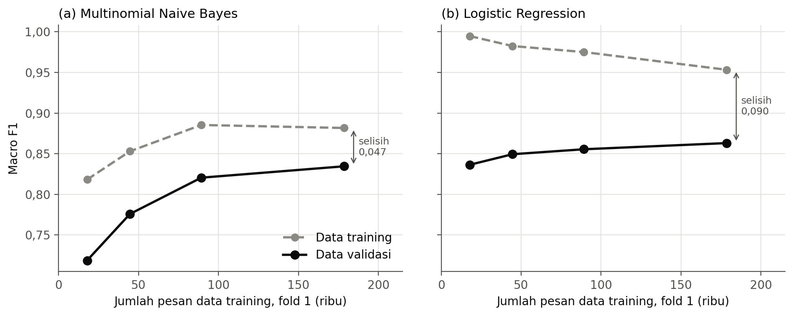
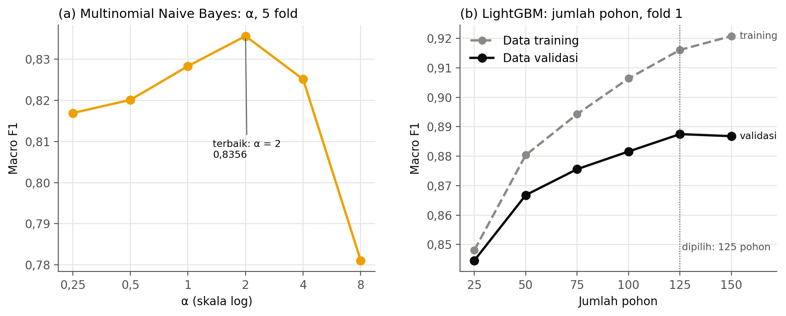
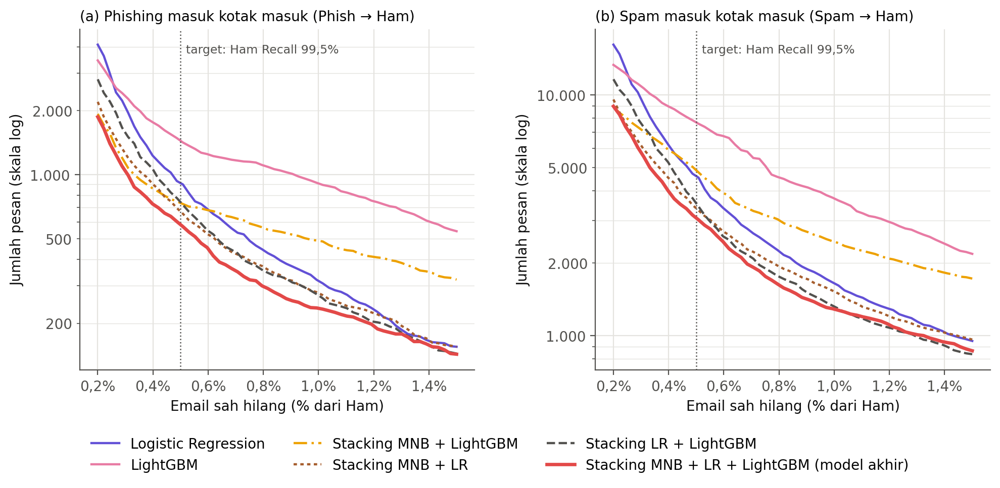
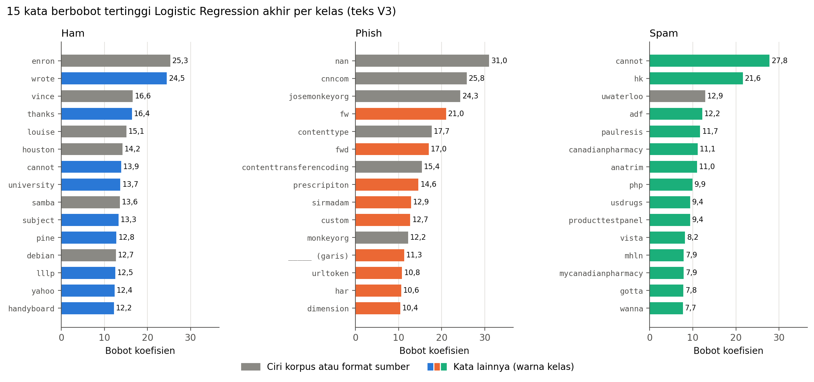

# Klasifikasi *Email* Ham, Phish, dan Spam Menggunakan *Stacking* Multinomial Naive Bayes, Logistic Regression, dan LightGBM

**Laporan *Milestone* 1 (UTS) — IF2116 Pembelajaran Mesin**

*Project ID* 1 · Kelompok 1

Anggota kelompok:

1. Jason Nathanael (231110013)
2. Andrew Senna Wijaya (231111369)

Dataset: [`locuoco/the-biggest-spam-ham-phish-email-dataset-300000`](https://huggingface.co/datasets/locuoco/the-biggest-spam-ham-phish-email-dataset-300000)

---

## Abstrak

Penelitian ini mengklasifikasikan *email* ke dalam tiga kelas, yaitu Ham (*email* sah), Phish (penipuan), dan Spam, dengan *classical machine learning*. Perlindungan *email* sah menjadi prioritas utama sehingga ditetapkan target Ham Recall minimal 99,5%. Dataset berisi 365.448 pesan dan menyisakan 278.941 pesan unik setelah pembersihan. Analisis data menunjukkan bahwa setiap kelas berasal dari sumber yang memformat teks secara berbeda. Setelah format tersebut diseragamkan, Macro F1 *cross-validation* turun 0,10–0,13 sehingga sebagian performa awal bergantung pada format sumber, bukan pada isi pesan. Model akhir adalah *stacking* Multinomial Naive Bayes, Logistic Regression, dan LightGBM dengan *threshold* Ham yang dipilih melalui *cross-validation*. Pada data *testing*, model memperoleh Macro F1 0,8913 dan Ham Recall 0,9963 sehingga target tercapai. Dibandingkan baseline (Macro F1 0,8377), *email* sah yang hilang turun dari 174 menjadi 94 dan phishing yang masuk kotak masuk turun dari 538 menjadi 107. Kata khas korpus asal masih tersisa sehingga performa pada *email* dari sumber lain belum teruji.

**Kata kunci:** klasifikasi *email*, phishing, *stacking*, format sumber data, *dataset shift*

---

## Cakupan *Milestone* 1

Butir minimum UTS pada panduan *final project* dibahas pada bagian berikut:

1. *Problem formulation*: Bab 1 dan 2.
2. Dataset dan sumber data: Subbab 3.1.
3. *Data understanding*: Subbab 3.2, 3.3, dan 3.6.
4. EDA: Subbab 3.4 dan 3.5.
5. *Pre-processing*: Bab 4.
6. *Feature engineering* awal: Bab 5.
7. Baseline: Subbab 7.1.
8. Beberapa model kandidat awal: Subbab 7.2–7.4.
9. Strategi evaluasi: Bab 6.
10. Hasil eksperimen awal: Bab 8, 10, dan 11.
11. Analisis awal: Bab 9 dan 13.
12. Rencana pengembangan setelah UTS: Bab 16.

---

## 1. Pendahuluan

### 1.1 Latar Belakang

*Email* adalah salah satu saluran komunikasi terpenting dalam organisasi, tetapi juga menjadi jalur utama pesan yang tidak diinginkan. Spam menghabiskan waktu dan ruang penyimpanan. Phishing lebih berbahaya karena berusaha memancing penerima memberikan kata sandi, data pribadi, atau uang. Penyaring berbasis aturan dan daftar alamat sulit mengikuti perubahan strategi pengirim sehingga penyaringan berbasis pembelajaran dari contoh berlabel banyak dipakai [1].

Dampak setiap jenis kesalahan penyaring tidak sama. *Email* sah yang tersaring dapat berupa pesan klien atau dokumen kerja yang tidak pernah dibaca. Phishing yang lolos ke kotak masuk dapat menyebabkan kebocoran data. Spam yang lolos hanya mengganggu. Karena itu, model tidak cukup dinilai dari akurasi; jenis kesalahannya juga harus dinilai.

### 1.2 Masalah

Permasalahan penelitian ini adalah membangun model *classical machine learning* yang mengklasifikasikan teks *email* secara otomatis ke dalam tiga kelas: Ham, Phish, dan Spam. Fokusnya adalah membantu penyaringan pesan berdasarkan isi teks, bukan sekadar mengejar akurasi tertinggi. *Deep learning* tidak digunakan karena berada di luar ruang lingkup mata kuliah.

### 1.3 Tujuan

1. Membangun *pipeline* klasifikasi teks untuk kelas Ham, Phish, dan Spam, dari data mentah sampai prediksi.
2. Memahami karakteristik, kualitas, dan potensi bias dataset sebelum pelatihan.
3. Membentuk baseline, lalu membandingkan beberapa model kandidat secara adil terhadap baseline tersebut.
4. Memilih model akhir berdasarkan bukti eksperimen dan prioritas bisnis, lalu mengevaluasinya satu kali pada data *testing*.

---

## 2. *Problem Formulation*

### 2.1 Definisi Masalah

Untuk setiap teks *email*, model menentukan apakah *email* tersebut termasuk Ham, Phish, atau Spam. Keputusan model menentukan ke mana *email* dikirim sehingga setiap jenis kesalahan memiliki akibat yang berbeda.

### 2.2 Konteks Penggunaan

Model dirancang sebagai penyaring pada *server email* organisasi. Setiap *email* masuk diklasifikasikan sebelum mencapai kotak masuk. *Email* yang diprediksi Ham dikirim ke kotak masuk. *Email* yang diprediksi Spam dipindahkan ke *folder* spam. *Email* yang diprediksi Phish juga dipindahkan ke *folder* spam, tetapi disertai peringatan phishing. Gambar 2.1 menunjukkan seluruh alur, dari data mentah sampai tindakan tersebut. Model akhir dievaluasi satu kali pada data *testing*, setelah model dan *threshold* ditetapkan.

Dengan tindakan ini, Phish → Spam (aktual → prediksi) masih menjauhkan *email* dari kotak masuk, tetapi tanpa peringatan phishing. Sebaliknya, Phish → Ham dan Spam → Ham meloloskan *email* ke kotak masuk.

### 2.3 Pengguna Hasil

Pengguna hasil penelitian ini adalah *stakeholder* yang ditetapkan pada tahap *Business Understanding*:

- ***System Administrator*** memasang penyaring dan mengatur *threshold* Ham.
- **Tim *IT Security*** menerima *email* yang ditandai Phish untuk ditindaklanjuti.
- ***Customer Service*** membutuhkan *email* pelanggan yang tidak hilang di *folder* spam.
- **Manajemen Bisnis** menilai risiko kebocoran data dan biaya gangguan.
- **Seluruh staf** adalah penerima *email* dan terdampak langsung oleh setiap kesalahan.

### 2.4 Mengapa *Machine Learning* Relevan

Ciri phishing dan spam terus berubah, dan sebagian besar cirinya ada pada kata dan frasa, bukan pada satu aturan sederhana. Dataset menyediakan ratusan ribu *email* berlabel sehingga pola pembeda dapat dipelajari dari contoh. Model *classical machine learning* untuk teks juga cepat dilatih dan dapat diinterpretasikan, misalnya melalui bobot setiap kata.

### 2.5 Jenis Masalah, Target, dan Fitur

Masalah ini termasuk *supervised learning*, tepatnya klasifikasi teks (*text classification*) dengan tiga kelas dan satu label per pesan (*multiclass single-label*). Targetnya adalah kolom `label`: 0 = Ham, 1 = Phish, 2 = Spam. Fitur mentahnya adalah kolom `text`, yaitu isi *email*. Fitur model adalah representasi numerik dari `text`, berupa frekuensi kata atau TF-IDF (*term frequency–inverse document frequency*) [2], yang dibentuk di dalam *pipeline* (Bab 5).

### 2.6 Ukuran Keberhasilan

Kriteria sukses tahap *Business Understanding* meminta *recall* yang tinggi untuk ancaman dan tingkat *false positive* yang sangat rendah. Kriteria tersebut diterjemahkan menjadi urutan prioritas kesalahan, dari yang paling berat:

1. *email* sah hilang (Ham → Spam atau Ham → Phish);
2. phishing masuk kotak masuk (Phish → Ham);
3. spam masuk kotak masuk (Spam → Ham);
4. phishing tersaring tanpa peringatan (Phish → Spam);
5. spam ditandai sebagai phishing (Spam → Phish).

Setelah perlindungan *email* sah, prinsip berikutnya adalah bahwa *email* tidak diinginkan yang sampai ke kotak masuk merupakan kesalahan yang lebih berat daripada *email* yang tetap tersaring ke *folder* spam.

Keberhasilan model akhir dinilai dengan empat ukuran:

1. **Ham Recall ≥ 99,5%**, yaitu paling banyak 1 dari 200 *email* sah hilang (prioritas 1).
2. **Macro F1 setinggi mungkin** pada Ham Recall tersebut. Macro F1 memberi bobot sama pada ketiga kelas sehingga Phish yang paling sedikit tidak tertutupi kelas besar.
3. **Phish → Ham dan Spam → Ham serendah mungkin** (prioritas 2 dan 3).
4. **Lebih baik daripada baseline** pada ketiga prioritas pertama, pada data *testing* yang sama. Model yang lebih kompleks harus terbukti memberikan perbaikan.

---

## 3. Dataset dan *Data Understanding*

### 3.1 Sumber Dataset

Dataset berasal dari Hugging Face ([`locuoco/the-biggest-spam-ham-phish-email-dataset-300000`](https://huggingface.co/datasets/locuoco/the-biggest-spam-ham-phish-email-dataset-300000)) [3] dan dimuat dengan `datasets.load_dataset` pada *split* `train`. Dataset memiliki 365.448 baris dan dua kolom: `text` (isi pesan) dan `label` (kelas). Unit observasinya adalah satu pesan *email*. Sebagian besar teks berupa isi *email*, tetapi sebagian masih memuat sisa *header*, misalnya baris tanggal atau blok "original message" dari *email* yang diteruskan.

Teks sudah diproses oleh penyusun dataset sebelum diunggah: seluruh huruf diubah menjadi huruf kecil, dan pada sebagian sumber angka diganti dengan `escapenumber`. Subbab 3.6 menunjukkan bahwa pemrosesan ini berbeda antarkelas.

### 3.2 Distribusi Kelas

Tabel 3.1 menunjukkan jumlah pesan setiap kelas sebelum dan setelah pembersihan.

Tabel 3.1 Distribusi Kelas

| Kelas | Jumlah pesan mentah | Persentase | Setelah pembersihan | Persentase |
| --- | ---: | ---: | ---: | ---: |
| Ham | 168.455 | 46,10% | 127.740 | 45,79% |
| Phish | 42.845 | 11,72% | 42.838 | 15,36% |
| Spam | 154.148 | 42,18% | 108.363 | 38,85% |
| **Total** | **365.448** | | **278.941** | |

Rasio Ham terhadap Phish pada data mentah adalah 3,93:1. Setelah duplikat dihapus, rasionya menjadi 2,98:1 karena duplikat lebih banyak terdapat pada Ham dan Spam. Ketidakseimbangan ini tergolong sedang. Namun, akurasi tetap dapat menyesatkan karena kesalahan pada kelas kecil hampir tidak mengubah akurasi [4]. Pada baseline, akurasi mencapai 0,8881, padahal Phish Recall hanya 0,5316 (Subbab 7.1). Oleh karena itu, evaluasi memakai Macro F1 dan metrik per kelas.

### 3.3 Kualitas Data

Tabel 3.2 merangkum hasil pemeriksaan kualitas data.

Tabel 3.2 Pemeriksaan Kualitas Data

| Pemeriksaan | Temuan | Tindakan |
| --- | --- | --- |
| Teks kosong (*missing*) | 2 | Dihapus |
| Teks yang hanya berisi spasi | 1 | Dihapus |
| Label di luar 0, 1, 2 | 0 | — |
| Teks duplikat (di luar kemunculan pertama) | 84.498 pada teks mentah; 86.460 duplikat berlabel sama setelah normalisasi spasi dan huruf kecil (dihitung setelah teks berlabel berbeda dihapus) | Duplikat dengan label sama dihapus sebelum pembagian data (Subbab 4.1) |
| Teks yang sama dengan label berbeda | 14 kelompok, 44 baris (setelah normalisasi spasi dan huruf kecil) | Seluruh barisnya dihapus |
| Pesan dengan karakter non-ASCII | 33.387 | Dipertahankan |
| Panjang teks | Median 763 karakter; maksimum 11.510.306 karakter | Dipertahankan (Subbab 3.4) |

Teks dengan label berbeda, misalnya "unsubscribe" yang berlabel Ham dan Spam, dihapus seluruhnya karena label yang benar tidak dapat ditentukan. Pesan non-ASCII sebagian berbahasa lain atau rusak, tetapi *email* nyata juga memuatnya sehingga tetap dipakai.

### 3.4 Eksplorasi Data (EDA)

EDA (*exploratory data analysis*) dilakukan pada data mentah dengan empat fitur bantu yang **tidak** dipakai sebagai masukan model: jumlah karakter (`char_count`), jumlah kata (`word_count`), jumlah kata `http`, `https`, atau `www` (`link_token_count`), dan jumlah karakter selain huruf, angka, *underscore*, dan spasi (`special_char_count`).

**Univariat.** Panjang pesan sangat condong ke kanan. Median jumlah kata adalah 125, sedangkan pesan terpanjang memuat 1.585.483 kata. Pencilan didefinisikan sebagai pesan dengan jumlah kata di atas Q3 + 1,5 × IQR (*interquartile range*), yaitu 590,5 kata. Terdapat 30.385 pencilan (8,31%): 18.677 Ham, 887 Phish, dan 10.821 Spam.

**Bivariat.** Gambar 3.1 membandingkan panjang pesan antarkelas. Phish memiliki pesan terpendek sehingga model memiliki lebih sedikit petunjuk untuk mengenalinya. Phish juga paling jarang memuat token tautan (11,8%, dibandingkan 33,5% pada Ham dan 44,8% pada Spam), padahal phishing biasanya berisi tautan. Subbab 3.6 menjelaskan penyebabnya: tautan pada sumber Phish tertulis menyatu menjadi satu kata.

Keterangan: data mentah dengan sumbu skala log. Garis putus-putus menandai batas pencilan pada Subbab 3.4 (590,5 kata). Garis (*whisker*) setiap kotak dihitung pada skala log untuk setiap kelas sehingga sebagian besar pencilan tetap tampak; 5.584 pesan di luar *whisker* tidak ditampilkan agar kotak tetap terbaca.

**Multivariat.** `char_count` dan `word_count` berkorelasi hampir sempurna (Spearman 0,98; Pearson 0,96) sehingga keduanya membawa informasi yang sama. `special_char_count` hampir tidak berkorelasi linear dengan panjang pesan (Pearson 0,08–0,09).

**Temuan dan keputusan yang dipengaruhinya:**

- Kelas tidak seimbang (rasio Ham:Phish 3,93:1) sehingga data dibagi secara *stratified* dan evaluasi memakai Macro F1 serta metrik per kelas.
- Panjang teks sangat condong (8,31% pencilan) sehingga TF-IDF memakai `sublinear_tf=True`. Pesan panjang tidak dihapus karena juga muncul pada *email* nyata.
- Phish paling pendek sehingga kesalahan diperkirakan terkonsentrasi pada pesan pendek. Dugaan ini diperiksa pada Subbab 9.3.
- Tautan tersimpan sebagai kata terpisah (`http www contoh com`) sehingga kata tautan tidak dihapus pada baseline.
- Jumlah karakter dan jumlah kata membawa informasi yang sama. Jika fitur panjang pesan diperlukan, satu fitur sudah cukup.

### 3.5 Eksplorasi Tanpa Label

*Clustering* dipakai untuk melihat apakah *email* membentuk kelompok alami tanpa melihat label. TF-IDF data *training* direduksi dengan TruncatedSVD (*truncated singular value decomposition*) [5] menjadi 100 komponen, lalu dikelompokkan dengan K-Means untuk K = 2–12. Tabel 3.3 merangkum hasilnya.

Tabel 3.3 Hasil *Clustering*

| Hasil | Nilai |
| --- | --- |
| *Silhouette* terbaik [6] | 0,0906 pada K = 4 (sampel 10.000 pesan) |
| Batas "struktur substansial" menurut Kaufman dan Rousseeuw [7] | > 0,25 |
| Kesepakatan K-Means dan Ward (ARI, *adjusted Rand index*) | 0,38 (sampel 5.000 pesan, K = 4) |
| Klaster murni Phish (K = 7) | 17.281 pesan (99,8% Phish, sekitar separuh Phish data *training*) |
| Klaster murni Ham (K = 7) | 32.619 pesan (98,8% Ham); 44,3% memuat kata `enron` |

*Email* tidak membentuk kelompok alami yang terpisah jelas. Kelompok yang paling jelas mengikuti **sumber data**, bukan isi pesan. Kata teratas klaster Phish adalah `2008 aug 06 wed 07 thu 0000 0300`, yaitu *timestamp header email*. Hampir separuh (44,3%) pesan pada klaster Ham terbesar memuat kata `enron`, yang menandai korespondensi perusahaan Enron. Temuan ini menjadi dasar Hipotesis 4 (Subbab 3.6).

### 3.6 Potensi Bias dan Keterbatasan Data

Dataset menggabungkan beberapa korpus, dan setiap kelas sebagian besar berasal dari korpus yang berbeda. Teks dari setiap korpus tampak telah diproses dengan cara yang berbeda sebelum digabungkan. Gambar 3.2 menunjukkan perbedaan format yang ditemukan pada data *training*.

Keterangan: persentase pesan pada data *training* yang memiliki setiap ciri format, sebelum teks diseragamkan.

Sumber Phish menyimpan angka asli, tetapi tidak memiliki *stopword* maupun tanda baca. Sumber Ham dan Spam sebaliknya: angkanya disamarkan menjadi `escape…`, dan teksnya memuat *stopword* serta tanda baca. *Timestamp header* paling sering muncul pada Phish (67,6%), tetapi juga muncul pada 41,1% Ham, sebagian besar dengan angka yang disamarkan. Median porsi kata *stopword* NLTK (*Natural Language Toolkit*) per pesan adalah 30,5% pada Ham dan 26,3% pada Spam, tetapi 0,0% pada Phish.

Perbedaan ini berasal dari pemrosesan sumber, bukan dari isi *email*. Oleh karena itu, perbedaan tersebut tidak dapat diharapkan muncul pada *email* nyata. Jika model belajar "memuat angka asli → Phish" atau "tidak ada *stopword* → Phish", model mengenali **sumber** *email*, bukan isinya. Temuan ini, bersama hasil *clustering* (Subbab 3.5) dan pembacaan contoh kesalahan (Subbab 9.2), menghasilkan dua hipotesis yang diuji pada Bab 8:

- **Hipotesis 4.** Model mengenali Phish dari format angka dan tanggal sumbernya.
- **Hipotesis 5.** Model mengenali Phish dari tidak adanya *stopword* dan dari tautan yang menyatu.

Keterbatasan lain yang ditemukan:

1. **Ciri korpus pada kosakata.** Nama dan alamat khas korpus tetap ada, misalnya `enron`, `vince`, `louise` (staf Enron, Ham), `josemonkeyorg` (alamat penerima korpus phishing), dan `uwaterloo` (Spam).
2. **Definisi label mengikuti korpus.** Sebagian pesan berlabel Phish adalah penawaran obat atau pekerjaan yang lebih mirip spam. Sebagian Ham adalah *newsletter* komersial.
3. **Teks yang hampir sama.** Deduplikasi hanya menghapus teks identik. *Email* dari satu *template* dengan nama berbeda masih dapat muncul di data *training* dan validasi (Subbab 9.4).

---

## 4. *Data Pre-processing*

### 4.1 Pembersihan Data

Pembersihan dibuat minimal agar informasi pada teks tidak hilang. Langkah yang dilakukan:

1. menghapus baris dengan teks atau label kosong;
2. menghapus label di luar 0, 1, dan 2;
3. mengubah spasi berlebih (spasi ganda, tab, baris baru) menjadi satu spasi, lalu menghapus teks yang menjadi kosong;
4. menghapus seluruh teks yang muncul dengan lebih dari satu label;
5. menghapus duplikat dengan teks dan label sama, dan hanya menyimpan kemunculan pertama.

Duplikat dideteksi dengan membandingkan teks dalam huruf kecil. Tabel 4.1 menunjukkan jumlah pesan yang tersisa setelah setiap tahap.

Tabel 4.1 Jumlah Pesan Setelah Setiap Tahap Pembersihan

| Tahap | Pesan tersisa |
| --- | ---: |
| Data awal | 365.448 |
| Setelah teks kosong dihapus | 365.446 |
| Setelah teks berisi spasi saja dihapus | 365.445 |
| Setelah teks dengan label berbeda dihapus | 365.401 |
| Setelah duplikat dihapus | **278.941** |

Deduplikasi dilakukan **sebelum** data dibagi. Tanpa langkah ini, teks yang sama dapat muncul di data *training* dan data *testing* sehingga model diuji pada teks yang sudah dipelajarinya (*data leakage*: informasi dari data *testing* ikut memengaruhi pelatihan).

Pencilan panjang tidak dipangkas. Pesan yang sangat panjang juga muncul pada *email* nyata. Pada representasi TF-IDF (baseline dan Logistic Regression), pengaruhnya dikendalikan dengan skala logaritmik pada bobot kata (`sublinear_tf=True`).

### 4.2 Pembagian Data

Data bersih dibagi menjadi 80% data *training* dan 20% data *testing* secara *stratified* dengan `random_state=42` (Tabel 4.2).

Tabel 4.2 Pembagian Data *Training* dan Data *Testing*

| Bagian | Ham | Phish | Spam | Total |
| --- | ---: | ---: | ---: | ---: |
| Data *training* | 102.192 | 34.270 | 86.690 | 223.152 |
| Data *testing* | 25.548 | 8.568 | 21.673 | 55.789 |

Pembagian yang sama dipakai pada seluruh eksperimen. Pada alur eksperimen utama, data *testing* hanya dipakai dua kali: untuk baseline dan untuk evaluasi akhir model terpilih (Subbab 6.1).

Setiap *vectorizer* dan setiap teknik *resampling* berada di dalam *pipeline* sehingga hanya dilatih pada bagian *training*. Pada *cross-validation*, keduanya dilatih ulang pada setiap *fold*. Tidak ada teks yang sama antara bagian *training* dan validasi pada setiap *fold*.

### 4.3 Penyeragaman Format Sumber

Untuk menguji Hipotesis 4 dan 5, disusun empat versi teks. Setiap versi diterapkan dengan aturan yang sama pada **setiap** *email* di **setiap** kelas. Data asli tidak diubah; model dilatih pada salinan teks hasil penyeragaman.

- **V0** adalah teks asli.
- **V1** mengganti tanda baca dengan spasi, lalu mengganti setiap kata yang memuat angka dan setiap `escapenumber` atau `escapelong` dengan `numtoken`.
- **V2** menambahkan dua langkah. *Timestamp header email* dihapus seluruhnya, baik angkanya asli maupun disamarkan. Nama bulan dan hari yang tersisa diganti `datetoken`, kecuali `may`, yang biasanya kata kerja.
- **V3** menambahkan dua langkah lagi. Kata yang diawali `http`, terpisah maupun menyatu, diganti `urltoken`, dan kata `www`, `com`, `net`, `org`, `edu`, `gov` yang berdiri sendiri dihapus. Lalu *stopword* NLTK dihapus: 153 kata unik tanpa bentuk yang memakai tanda apostrof.

Langkah V3 dijalankan dalam urutan berikut:

1. tanda baca → spasi;
2. *timestamp header* dihapus;
3. tautan → `urltoken`;
4. angka dan `escape…` → `numtoken`;
5. nama bulan dan hari → `datetoken`;
6. *stopword* dihapus.

Urutan ini penting: *timestamp* dan tautan memuat angka sehingga keduanya harus dikenali sebelum angka diganti. Sebagai contoh, teks Phish `specialpricespharm tue 05 aug 2008 193121 0400 order now` menjadi `specialpricespharm order`. Teks Ham `original message from rodriguez grace sent friday june escapenumber escapenumber … am to fitzpatrick amy` menjadi `original message rodriguez grace sent fitzpatrick amy`.

**Alasan setiap langkah:**

- *Timestamp* dihapus seluruhnya, bukan hanya angkanya. Jika hanya angka dan nama hari yang diganti, *timestamp* Phish tetap menjadi urutan khas `datetoken numtoken datetoken …`.
- *Timestamp* Ham dan Spam yang angkanya disamarkan juga dihapus. Jika tidak, nama bulan dan hari menjadi penanda Ham, yaitu jalan pintas (*shortcut*) yang sama dengan arah terbalik. Jalan pintas adalah ciri yang memisahkan kelas pada dataset ini, tetapi tidak berkaitan dengan isi pesan.
- Angka diganti satu token, bukan dihapus. Token ini mempertahankan informasi bahwa ada angka (harga, jumlah, kode) tanpa membawa format sumbernya.
- Daftar *stopword* NLTK dipilih karena median porsi kata NLTK per pesan pada sumber Phish adalah 0,0%, tetapi sumber tersebut masih memuat kata dari daftar yang lebih panjang, misalnya `please`. Hal ini menunjukkan bahwa daftar *stopword* sumber Phish kemungkinan besar sama dengan daftar NLTK. Daftar scikit-learn yang lebih panjang akan ikut menghapus kata isi seperti `please`, `call`, dan `system`.

**Aturan keputusan**, ditetapkan sebelum hasil terlihat:

- Model akhir memakai versi teks yang paling seragam karena format sumber tidak ada pada *email* nyata.
- Hipotesis dinyatakan didukung jika Macro F1 Multinomial Naive Bayes atau Logistic Regression turun lebih dari 0,005, sekitar lima kali simpangan baku antar-*fold*.

### 4.4 Langkah yang Sengaja Tidak Dilakukan

- ***Stemming* dan *lemmatization*.** Bentuk kata seperti `verify` dan `verified` dapat membawa perbedaan, dan belum ada bukti pada dataset ini bahwa penggabungan bentuk kata membantu.
- **Penghapusan *stopword* pada baseline.** *Stopword* baru dihapus pada V3 karena didukung sebagai ciri sumber (Hipotesis 5), bukan sebagai praktik umum.
- **Pemangkasan pencilan.** Pesan panjang juga muncul pada *email* nyata (Subbab 4.1).
- **Penghapusan blok "original message … from … sent … subject".** Rantai balasan wajar pada *email* kerja. Pada dataset ini blok tersebut sebagian besar berasal dari Enron sehingga dicatat sebagai keterbatasan (Bab 14).

---

## 5. *Feature Engineering* dan *Feature Selection*

### 5.1 TF-IDF dan Frekuensi Kata

Model tidak dapat membaca teks secara langsung sehingga setiap *email* diubah menjadi vektor angka. Dua representasi dibandingkan pada validasi (data *training* 178.521 pesan, validasi 44.631 pesan). Hasilnya ditunjukkan pada Tabel 5.1.

Tabel 5.1 Representasi Teks untuk Multinomial Naive Bayes

| Representasi | Macro F1 | Phish Recall |
| --- | ---: | ---: |
| TF-IDF *unigram* | 0,8286 | 0,5144 |
| Frekuensi kata *unigram* | **0,9323** | **0,9498** |

Multinomial Naive Bayes memodelkan berapa kali setiap kata muncul sehingga frekuensi kata adalah masukan alaminya [8]. Penyebab lemahnya TF-IDF diperiksa dari rumus estimasinya:

P(kata | kelas) = (bobot kata pada kelas + α) / (total bobot kelas + α × |V|)

*Laplace smoothing* menambahkan α pada setiap kata sehingga setiap kelas mendapat tambahan α × |V| = 664.008. Dengan TF-IDF, bobot setiap pesan hanya berjumlah beberapa satuan sehingga total bobot Phish hanya 207.178, atau 0,31 kali tambahan *smoothing*. Probabilitas kata Phish menjadi hampir rata, dan model jarang memprediksi Phish. Dengan frekuensi kata, total Phish adalah 3.249.018 (4,9 kali *smoothing*) sehingga masalah ini tidak terjadi.

Logistic Regression tetap memakai TF-IDF dengan `sublinear_tf=True`. Model ini mempelajari bobot setiap kata secara langsung sehingga tidak terpengaruh *smoothing*.

### 5.2 Batas Ukuran Kosakata

Batas 50.000 kata menaikkan Macro F1 TF-IDF + Multinomial Naive Bayes sebesar 0,0675, tetapi tidak mengubah hasil frekuensi kata (0,9324 dibandingkan 0,9323). Menurunkan α menjadi 0,1 tanpa membuang satu kata pun memberi kenaikan 0,0619. Jadi, sebagian besar kenaikan tersebut dapat dijelaskan oleh *smoothing* yang lebih kecil, bukan oleh kata yang dibuang. Model akhir tidak memakai batas ukuran kosakata (`max_features`).

### 5.3 Pasangan Kata (*Bigram*)

Hipotesis 2 menyatakan bahwa kata tunggal (*unigram*) tidak menangkap frasa seperti *verify your account*. Dengan filter `min_df=2` yang sama pada kedua sisi, *unigram* + *bigram* menaikkan Macro F1 dari 0,9342 menjadi 0,9443 (+0,0101). Hipotesis 2 didukung sehingga Multinomial Naive Bayes memakai *unigram* + *bigram*. Filter `min_df=2` menyimpan hanya pasangan kata yang muncul pada minimal dua pesan karena jumlah pasangan kata yang berbeda sangat besar.

### 5.4 Fitur LightGBM

LightGBM memakai frekuensi *unigram* yang muncul pada minimal 20 pesan. Batas ini dipakai untuk mengurangi jumlah fitur dan waktu pelatihan.

### 5.5 Seleksi Fitur

Seleksi fitur diuji dengan *filter chi-square* di dalam setiap *fold*, pada teks V3 dan Multinomial Naive Bayes. *Chi-square* cocok untuk fitur nonnegatif seperti frekuensi kata. Metode *wrapper* seperti RFE (*recursive feature elimination*) tidak dipakai karena membutuhkan ribuan kali pelatihan pada jutaan fitur. Tabel 5.2 menunjukkan hasilnya.

Tabel 5.2 Macro F1 pada Setiap Jumlah Kata Terpilih

| Jumlah kata terpilih (k) | 10.000 | 50.000 | 200.000 | 1.000.000 | Semua |
| --- | ---: | ---: | ---: | ---: | ---: |
| Macro F1 (5 *fold*) | 0,7492 | 0,7912 | 0,8167 | 0,8330 | **0,8356** |

Aturannya: pilih k terkecil yang berada dalam 0,001 dari "semua kata". Tidak ada k yang memenuhi sehingga seluruh kata dipakai.

### 5.6 Reduksi Dimensi

TruncatedSVD diuji sebagai masukan Logistic Regression dengan lima *fold* yang sama. PCA (*principal component analysis*) tidak dapat dipakai karena PCA mengurangi rata-rata setiap kolom dan mengubah matriks *sparse* menjadi matriks padat yang tidak muat di memori. Hasil terbaik dengan SVD 200 komponen adalah Macro F1 0,9443, dibandingkan 0,9655 tanpa reduksi (−0,0213). Reduksi dimensi tidak dipakai.

---

## 6. *Experimental Design*

### 6.1 Protokol Data

Data *training* dan data *testing* dipakai dengan aturan berikut:

1. **Baseline** dilatih pada data *training* dan dievaluasi satu kali pada data *testing*.
2. **Perbandingan representasi dan model awal** memakai validasi *hold-out*, yaitu 20% data *training* (44.631 pesan).
3. **Seluruh pemilihan model, *tuning*, dan *threshold*** memakai *stratified 5-fold cross-validation* pada 223.152 pesan *training*. Pengecualiannya adalah jumlah pohon LightGBM, yang dipilih pada *fold* 1, dan tiga parameter LightGBM lain, yang ditetapkan dari uji pendahuluan di luar *notebook* (Bab 10).
4. **Model akhir** dievaluasi satu kali pada data *testing*.

Data *testing* tidak dipakai untuk memilih model, parameter, maupun *threshold*. Jika model dipilih berdasarkan skor data *testing*, data *testing* berubah menjadi data validasi, dan skor akhirnya terlalu optimistis.

### 6.2 Satu Faktor per Eksperimen

Sedapat mungkin, setiap eksperimen mengubah satu faktor, misalnya hanya bobot kata, lalu hanya ukuran kosakata, lalu hanya panjang frasa. Jika dua faktor berubah bersamaan, penyebab perubahan hasil tidak dapat diketahui. Pengecualiannya adalah V2 dan V3 (Subbab 4.3), yang masing-masing menambahkan dua langkah sekaligus.

### 6.3 Metrik

- **Macro F1** adalah metrik utama pemilihan model.
- **Ham Recall** adalah batasan bisnis (≥ 99,5%).
- **Phish Recall** dan **Phish Precision** mengukur kemampuan mendeteksi phishing.
- **Jumlah setiap jenis kesalahan** menilai model terhadap prioritas bisnis (Subbab 2.6).
- **PR-AUC Phish** (*area under the precision–recall curve*) mengukur kemampuan mengurutkan Phish, tanpa bergantung pada *threshold*.
- **Rata-rata ± simpangan baku antar-*fold*** mengukur stabilitas hasil.
- **Interval kepercayaan *bootstrap* 95%** (1.000 sampel ulang) [9] mengukur ketidakpastian hasil data *testing* dan selisih antarmodel.
- **Waktu pelatihan** mengukur biaya komputasi.

### 6.4 *Threshold* Ham

Model memilih kelas dengan probabilitas tertinggi setelah konstanta b ditambahkan pada log P(Ham). Untuk setiap model, b adalah nilai terkecil yang menghasilkan Ham Recall ≥ 99,5% pada prediksi *out-of-fold*. Prediksi *out-of-fold* adalah prediksi untuk setiap *email* dari model yang tidak pernah melihat *email* tersebut.

Dengan aturan ini, semua model dibandingkan pada jumlah *email* sah hilang yang sama. Untuk model akhir, b = 1,777. *Email* hanya keluar dari kotak masuk jika probabilitas Spam atau Phish menurut model lebih dari e^1,777 ≈ 5,9 kali probabilitas Ham.

*Threshold* dipilih karena mengendalikan langsung kesalahan yang paling penting dengan satu angka yang mudah dijelaskan. Pemilihan *threshold* berdasarkan biaya kesalahan pada data validasi juga dianjurkan pada materi *imbalanced data* (minggu ke-5, halaman 44).

### 6.5 Aturan Pemilihan

Kecuali pemecah seri untuk model akhir, setiap aturan ditulis di *notebook* sebelum hasilnya terlihat.

- **Toleransi seri.** Selisih Macro F1 di bawah 0,001 dianggap seri. Nilai ini sekitar satu simpangan baku antar-*fold* pada teks V0 (0,0004–0,0011 pada lima model utama Pertemuan 5; lihat Subbab 15.1) sehingga selisih yang lebih kecil tidak dapat dibedakan dari *noise*.
- **Pemecah seri untuk model akhir.** Dipilih model dengan Phish → Ham paling sedikit, lalu Spam → Ham paling sedikit, lalu jumlah model dasar paling sedikit. Urutan ini mengikuti prioritas bisnis, dan kesederhanaan menjadi kriteria terakhir. Aturan ini diubah setelah hasil terlihat. Pada awalnya, pemecah seri hanya memakai jumlah model dasar paling sedikit sehingga *stack* Logistic Regression + LightGBM yang terpilih. Setelah kedua *stack* dibandingkan secara rinci pada prediksi *out-of-fold* (Tabel 11.2), urutannya diubah agar mengikuti prioritas bisnis, dengan kesederhanaan sebagai kriteria terakhir. Perubahan ini dilakukan sebelum data *testing* dipakai.
- **Pemecah seri untuk parameter.** Dipilih nilai yang lebih sederhana atau lebih cepat, misalnya k lebih kecil atau pohon lebih sedikit. Untuk α, dipilih Ham Recall yang lebih tinggi.
- **Hipotesis 4 dan 5** dinyatakan didukung jika Macro F1 turun lebih dari 0,005, sekitar lima kali simpangan baku antar-*fold*.

### 6.6 Lingkungan Eksperimen

Eksperimen dijalankan di Google Colab dengan scikit-learn 1.6.1, LightGBM 4.6.0, pandas 2.2.3, dan NumPy 2.4.6. Pertemuan 4 memakai NumPy 2.1.3, sedangkan versi NumPy pada Pertemuan 3 dan *notebook* Naive Bayes manual tidak tercatat. Seluruh pembagian data, *fold*, model, dan pengambilan sampel memakai `random_state=42`. Hasil eksperimen panjang disimpan ke Google Drive setelah setiap langkah sehingga eksperimen dapat dilanjutkan jika *runtime* terputus.

---

## 7. Baseline dan Model Kandidat

### 7.1 Baseline

Baseline adalah TF-IDF *unigram* + Multinomial Naive Bayes pada teks asli (V0) hasil pembersihan pada Subbab 4.1. TF-IDF memakai `sublinear_tf=True` dan seluruh kosakata (721.764 kata). Multinomial Naive Bayes memakai `alpha=1.0` tanpa *tuning*. Kombinasi ini dipilih karena merupakan pengklasifikasi teks klasik yang sederhana, cepat, dan umum dipakai. Tabel 7.1 menunjukkan hasil baseline pada data *testing*.

Tabel 7.1 Hasil Baseline pada Data *Testing*

| Kelas | Precision | Recall | F1 |
| --- | ---: | ---: | ---: |
| Ham | 0,9094 | 0,9932 | 0,9494 |
| Phish | 0,9844 | **0,5316** | 0,6904 |
| Spam | 0,8434 | 0,9051 | 0,8732 |

Akurasi baseline 0,8881, dan Macro F1-nya **0,8377**. Dari 8.568 Phish, 3.475 diprediksi sebagai Spam dan 538 sebagai Ham. Model hampir tidak pernah salah ketika memprediksi Phish (Phish Precision 0,9844), tetapi hanya mengenali separuh Phish. Penyebabnya dijelaskan pada Subbab 5.1.

### 7.2 Model Kandidat

Nama model ditulis sesuai nama aslinya dalam bahasa Inggris. Model kandidat yang dibandingkan adalah sebagai berikut.

1. **Multinomial Naive Bayes dengan representasi terbaik.** Algoritmanya sama dengan baseline sehingga perbedaan hasil hanya berasal dari representasi.
2. **Logistic Regression + TF-IDF.** Logistic Regression merupakan pengklasifikasi teks linear standar. Model ini mempelajari bobot setiap kata langsung dari kesalahannya (*discriminative*) sehingga dapat menurunkan bobot kata yang dipakai bersama oleh Phish dan Spam.
3. **Decision Tree** (`max_depth=20`, `min_df=5`). Model ini membentuk aturan ya/tidak yang mudah dibaca dan dipakai untuk menguji apakah sedikit aturan kata sudah cukup. Batas dipakai karena waktu pelatihan tumbuh dengan ukuran kosakata × jumlah simpul.
4. **LightGBM (*boosting*).** Model linear menilai setiap kata secara terpisah. Pohon *boosting* dapat mempelajari kombinasi kata, dan setiap pohon baru memperbaiki kesalahan pohon sebelumnya [10]. LightGBM dirancang untuk data besar dan *sparse* [11].
5. ***Stacking*.** Multinomial Naive Bayes dan Logistic Regression membuat jenis kesalahan yang berbeda (Subbab 7.3). *Meta-model* mempelajari cara menggabungkan prediksi model dasar [12].

Dua model tidak diuji. **KNN** (*k-nearest neighbors*) harus membandingkan satu *email* dengan sekitar 178.000 *email* pada sekitar 664.000 dimensi, dan jarak kehilangan makna pada dimensi yang sangat tinggi. **Random Forest** membutuhkan ratusan pohon yang dalam, sedangkan satu Decision Tree dengan kedalaman 20 sudah membutuhkan 233 detik.

### 7.3 Hasil Kandidat Awal (Validasi *Hold-out*, V0)

Tabel 7.2 membandingkan kandidat awal dengan baseline pada validasi *hold-out*.

Tabel 7.2 Hasil Kandidat Awal pada Validasi *Hold-out*

| Peran | Model | Macro F1 | Phish Recall | Phish Precision |
| --- | --- | ---: | ---: | ---: |
| Baseline | TF-IDF + Multinomial Naive Bayes | 0,8286 | 0,5144 | **0,9827** |
| Kandidat 1 | Frekuensi *unigram* + *bigram* + Multinomial Naive Bayes | 0,9443 | **0,9603** | 0,8820 |
| Kandidat 2 | TF-IDF + Logistic Regression | **0,9647** | 0,9320 | 0,9674 |
| Kandidat 3 | Decision Tree | 0,9022 | 0,8764 | 0,9282 |

Kedua kandidat terbaik membuat kesalahan yang berbeda (Tabel 7.3).

Tabel 7.3 Jenis Kesalahan Dua Kandidat Terbaik

| Kesalahan | Multinomial Naive Bayes | Logistic Regression |
| --- | ---: | ---: |
| Ham → Spam | **174** | 421 |
| Phish → Spam | **262** | 458 |
| Spam → Ham | 799 | **257** |
| Spam → Phish | 835 | **189** |

Multinomial Naive Bayes kehilangan lebih sedikit *email* sah, sedangkan Logistic Regression meloloskan lebih sedikit spam. Perbedaan ini menjadi alasan *stacking*. Kedua model dibawa ke tahap *cross-validation*.

### 7.4 *Ensemble* dan *Stacking*

Pada V0, LightGBM memakai 150 pohon, `learning_rate=0.2`, `num_leaves=63`, dan `colsample_bytree=0.3`. Nilai ini ditetapkan dari uji waktu dan kualitas pada sampel data sebelum *notebook* dijalankan, dan hasil uji tersebut tidak tercatat di *notebook*. *Tuning* yang lebih luas tidak dilakukan karena satu kali pelatihan LightGBM dengan lima *fold* sudah membutuhkan sekitar 119 menit. Pada V3, jumlah pohon di-*tuning* ulang menjadi 125 (Bab 10).

*Stacking* dibentuk sebagai berikut:

1. Setiap model dasar menghasilkan log-probabilitas *out-of-fold* untuk setiap *email* data *training*.
2. Log-probabilitas dibatasi pada rentang −30 sampai 0. Tanpa batas ini, log-probabilitas Multinomial Naive Bayes mencapai ribuan hingga jutaan satuan negatif dan mendominasi masukan *meta-model*.
3. Nilai-nilai tersebut distandarkan (`StandardScaler`), lalu menjadi sembilan fitur *meta-model* Logistic Regression.
4. *Meta-model* dievaluasi dengan lima *fold* yang sama sehingga tidak ada prediksi model dasar yang dibuat pada *email* yang pernah dilihat model tersebut.

### 7.5 Implementasi Manual Multinomial Naive Bayes

Subbab ini membahas verifikasi terpisah di luar alur eksperimen utama; hasilnya tidak dipakai untuk memilih model.

Multinomial Naive Bayes juga diimplementasikan tanpa *library* untuk memastikan cara kerjanya dipahami. Tokenisasi, penghitungan frekuensi kata, estimasi probabilitas, prediksi, *confusion matrix*, dan seluruh metrik evaluasi ditulis sendiri berdasarkan rumus berikut [2], [8]:

P(c) = D_c / D

P(kata | c) = (F_kata,c + α) / (T_c + α × |V|)

log S_c = log P(c) + Σ f(kata, x) × log P(kata | c)

D_c adalah jumlah *email* kelas c pada data *training*, dan D adalah jumlah seluruh *email* data *training*. F_kata,c adalah frekuensi kata pada kelas c, T_c adalah total kata pada kelas c, |V| adalah ukuran kosakata, dan f(kata, x) adalah frekuensi kata pada *email* x. Kelas dengan log S_c tertinggi menjadi prediksi. Perhitungan dilakukan dalam bentuk logaritma karena perkalian ribuan probabilitas kecil akan dibulatkan komputer menjadi nol (*underflow*).

Model manual memakai frekuensi kata *unigram*, α = 1, dan pola token yang sama dengan `CountVectorizer`. Data *training* dan data *testing*-nya sama dengan baseline. Kesamaan pembagian data dibuktikan dengan melatih ulang baseline pada pembagian tersebut: hasilnya tetap sama, yaitu akurasi 0,8881, Macro F1 0,8377, dan Phish Recall 0,5316.

**Verifikasi terhadap scikit-learn.** Implementasi manual dibandingkan dengan `CountVectorizer` + `MultinomialNB` dari scikit-learn yang dilatih dengan pengaturan yang sama. Perbandingan dilakukan pada setiap langkah perhitungan sehingga setiap kesalahan dapat ditemukan pada langkah pertama yang tidak sesuai (Tabel 7.4).

Tabel 7.4 Verifikasi Multinomial Naive Bayes Manual terhadap scikit-learn

| Langkah | Nilai yang dibandingkan | Jumlah nilai | Selisih terbesar |
| --- | --- | ---: | ---: |
| 1 | Kosakata | 721.764 kata | 0 kata berbeda |
| 2 | D_c (*email* per kelas) | 3 | 0 |
| 3 | T_c (kata per kelas) | 3 | 0 |
| 4 | F_kata,c (frekuensi setiap kata pada setiap kelas) | 2.165.292 | 0 |
| 5 | log P(c) | 3 | 7,8 × 10⁻¹⁶ |
| 6 | log P(kata \| c) | 2.165.292 | 3,6 × 10⁻¹⁵ |
| 7 | log S_c setiap *email* data *testing* | 167.367 | 3,3 × 10⁻¹⁴ (relatif) |
| 8 | Probabilitas *posterior* P(c \| x) | 167.367 | 2,5 × 10⁻¹² |
| 9 | Kelas hasil prediksi | 55.789 | 0 *email* berbeda |

Keterangan: bilangan bulat harus sama persis. Bilangan desimal dianggap sama jika selisih absolut atau relatifnya di bawah 10⁻⁹. Selisih sekecil ini berasal dari urutan penjumlahan yang berbeda, bukan dari rumus.

Kesembilan langkah sesuai. Kosakata, jumlah *email*, dan frekuensi setiap kata sama persis, dan kedua implementasi memberi prediksi yang sama pada seluruh 55.789 *email* data *testing*. Metrik yang dihitung sendiri juga sama dengan fungsi metrik scikit-learn, dan perhitungan manual pada enam *email* contoh sama dengan keluaran kode (probabilitas *posterior* Phish 0,75 untuk teks "verify password").

**Perbandingan dengan *library*.** Tabel 7.5 menempatkan implementasi manual di samping dua model *library* pada data *testing* yang sama. Model *library* dengan frekuensi kata memakai algoritma, masukan, dan α yang sama dengan model manual sehingga perbandingan keduanya menguji implementasi. Baseline memakai algoritma yang sama dengan masukan TF-IDF sehingga perbandingannya dengan model frekuensi kata menguji representasi.

Tabel 7.5 Multinomial Naive Bayes *Library* dan Manual pada Data *Testing*

| Metrik | *Library*, TF-IDF (baseline) | *Library*, frekuensi kata | Manual, frekuensi kata |
| --- | ---: | ---: | ---: |
| Akurasi | 0,8881 | **0,9416** | **0,9416** |
| Macro F1 | 0,8377 | **0,9337** | **0,9337** |
| Ham Recall | **0,9932** | 0,9832 | 0,9832 |
| Phish Recall | 0,5316 | **0,9568** | **0,9568** |
| Spam Recall | **0,9051** | 0,8866 | 0,8866 |
| *Email* sah hilang | **174** | 430 | 430 |
| Phish → Ham | 538 | **24** | **24** |
| Spam → Ham | 1.991 | **1.301** | **1.301** |
| Phish → Spam | 3.475 | **346** | **346** |

Keterangan: kolom *library* dengan frekuensi kata dan kolom manual identik karena prediksi keduanya sama pada setiap *email*.

Tabel 7.5 menunjukkan dua hal. Pertama, implementasi manual dan *library* dengan masukan yang sama memberi hasil yang identik. Kedua, selisih terhadap baseline (Macro F1 +0,0961) berasal dari representasi kata, bukan dari implementasi. Temuan ini sejalan dengan hasil validasi pada Subbab 5.1. Frekuensi kata menaikkan Phish Recall dari 0,5316 menjadi 0,9568, tetapi *email* sah yang hilang naik dari 174 menjadi 430.

Data *testing* pada subbab ini tidak dipakai untuk memilih apa pun. Nilai α = 1 ditetapkan sebelum hasil terlihat, dan model manual tidak menjadi bagian dari model akhir. Hasilnya juga tidak dibandingkan dengan model akhir karena model manual membaca teks V0, yang masih memuat jalan pintas format sumber (Subbab 8.3). Probabilitas kata pada model manual memperlihatkan jalan pintas tersebut secara langsung. Kata `this`, `is`, dan `being` tidak pernah muncul pada Phish data *training* sehingga P(this | Phish) sekitar 22.000 kali lebih kecil daripada P(this | Ham). Akibatnya, setiap *email* yang mengandung *stopword* umum terdorong menjauhi kelas Phish.

---

## 8. *Validation and Evaluation*

### 8.1 *Cross-Validation* pada Teks Asli (V0)

Tabel 8.1 menunjukkan Macro F1 dengan *threshold* bawaan, rata-rata lima *fold*. Simpangan baku antar-*fold* ≤ 0,0011.

Tabel 8.1 Macro F1 *Cross-Validation* pada Teks V0

| Model | Macro F1 |
| --- | ---: |
| Multinomial Naive Bayes (*unigram* + *bigram*, α = 1,0) | 0,9441 |
| Logistic Regression (C = 64) | 0,9687 |
| LightGBM | 0,9773 |
| *Stacking* Multinomial Naive Bayes + Logistic Regression + LightGBM | **0,9807** |

Simpangan baku kecil karena setiap *fold* memuat sekitar 44.600 pesan validasi.

### 8.2 Penanganan Ketidakseimbangan Kelas

Rasio kelas pada data *training* adalah Ham:Phish 2,98:1 dan Spam:Phish 2,53:1. Hipotesis 3 menyatakan bahwa jumlah Phish yang lebih sedikit membuat model cenderung memilih kelas besar [4]. Empat teknik dibandingkan dengan tanpa penanganan pada Multinomial Naive Bayes, termasuk SMOTE (*Synthetic Minority Over-sampling Technique*) [13]. *Resampling* hanya diterapkan pada bagian *training* setiap *fold*. Hasilnya ditunjukkan pada Tabel 8.2.

Tabel 8.2 Teknik Penanganan Ketidakseimbangan Kelas pada Multinomial Naive Bayes

| Teknik | Macro F1 | Phish Recall | *Email* sah hilang |
| --- | ---: | ---: | ---: |
| Tanpa penanganan | **0,9441** | 0,9598 | **1.050** |
| *Class weight* | 0,9353 | 0,9643 | 1.201 |
| *Random oversampling* | 0,9350 | 0,9571 | 1.150 |
| SMOTE | 0,9371 | 0,9504 | 1.102 |
| *Random undersampling* | 0,9328 | 0,9706 | 1.342 |

Tidak ada teknik yang menaikkan Macro F1, dan semuanya menghilangkan lebih banyak *email* sah. Logistic Regression dengan *class weight* naik hanya 0,0004, tetapi kehilangan 153 *email* sah lebih banyak. Hipotesis 3 tidak didukung, dan tidak ada teknik *resampling* yang dipakai. Alasannya:

1. ketidakseimbangan hanya sedang (sekitar 3:1);
2. SMOTE membuat *email* sintetis di antara dua *email* Phish (x_baru = x_i + λ(x_tetangga − x_i)), yaitu campuran frekuensi kata dua *email* yang tidak pernah ada;
3. *resampling* terutama menggeser batas keputusan, dan *threshold* Ham (Subbab 6.4) sudah melakukannya secara langsung dengan makna bisnis yang jelas.

### 8.3 Pengaruh Format Sumber (Hipotesis 4 dan 5)

Multinomial Naive Bayes (*unigram*) dan Logistic Regression dilatih pada keempat versi teks dengan lima *fold* yang sama. Gambar 8.1 menunjukkan hasilnya.

Keterangan: rata-rata lima *fold*. Area kiri menguji Hipotesis 4 (V0 → V2), dan area kanan menguji Hipotesis 5 (V2 → V3).

Tabel 8.3 merinci hasil setiap versi teks, termasuk jumlah ciri format dan *stopword* di antara kata yang paling diandalkan model.

Tabel 8.3 Hasil dan Kata yang Diandalkan Model pada Setiap Versi Teks

| Versi | Macro F1 MNB | Macro F1 LR | Phish Recall MNB | Phish Recall LR | Ciri format di 25 kata paling khas Phish | *Stopword* di 15 kata teratas LR (Ham / Spam) |
| --- | ---: | ---: | ---: | ---: | ---: | ---: |
| V0 | 0,9344 | 0,9687 | 0,9838 | 0,9425 | 17 | — |
| V1 | 0,8956 | 0,9476 | 0,9471 | 0,8919 | 0 | — |
| V2 | 0,8900 | 0,9423 | 0,9369 | 0,8819 | 0 | 3 / 8 |
| V3 | 0,8016 | 0,8658 | 0,7297 | 0,6776 | 0 | 0 / 0 |

Keterangan: MNB = Multinomial Naive Bayes (frekuensi *unigram*, α = 1,0); LR = Logistic Regression (C = 64). Macro F1 dan Phish Recall adalah rata-rata lima *fold*. Ciri format dihitung pada 25 kata paling khas Phish menurut MNB, dan *stopword* pada 15 kata berbobot tertinggi LR; keduanya pada *fold* 1. Tanda — berarti tidak diukur.

Kedua hipotesis didukung, dengan penurunan yang jauh di atas batas 0,005:

- **Hipotesis 4** (V0 → V2): Macro F1 turun 0,0444 pada Multinomial Naive Bayes dan 0,0263 pada Logistic Regression.
- **Hipotesis 5** (V2 → V3): Macro F1 turun 0,0884 dan 0,0766. Pada urutan pengujian ini, penurunan akibat *stopword* dan tautan lebih besar daripada penurunan akibat angka dan tanggal.

Phish Recall turun paling tajam dari V0 ke V3: dari 0,9838 menjadi 0,7297 pada Multinomial Naive Bayes, dan dari 0,9425 menjadi 0,6776 pada Logistic Regression. Artinya, sebagian penting kemampuan awal mendeteksi Phish bergantung pada cara sumber Phish diproses, bukan pada isi pesannya.

Daftar kata yang paling diandalkan model (Tabel 8.3) mendukung bahwa model memang memakai ciri tersebut. Pada V0, 17 dari 25 kata terkuat Phish adalah ciri format (angka asli dan tautan yang memuat angka atau tanggal). Setelah penyeragaman, token tersebut tidak lagi ada di dalam teks sehingga jumlahnya nol pada V1 sampai V3. Pada V2, 15 kata berbobot tertinggi Logistic Regression memuat 3 *stopword* untuk Ham (`to`, `the`, `for`) dan 8 untuk Spam (`and`, `no`, `your`, `to`, `you`, `of`, `our`, `here`); pada V3 jumlahnya nol karena *stopword* sudah dihapus. Hal ini menunjukkan bahwa pada V2, *stopword* menjadi penanda penting yang membedakan Spam dari Phish.

Model akhir memakai V3. Skor V3 lebih rendah, tetapi lebih realistis karena tidak lagi bergantung pada perbedaan format angka, tanggal, *stopword*, dan tautan. Ciri korpus pada kosakata masih tersisa (Subbab 13.2).

### 8.4 *Cross-Validation* pada Teks V3

Tabel 8.4 menunjukkan hasil dengan *threshold* bawaan, rata-rata lima *fold*.

Tabel 8.4 Hasil *Cross-Validation* pada Teks V3

| Model | Macro F1 | Ham Recall | Phish Recall | Phish Precision |
| --- | ---: | ---: | ---: | ---: |
| Multinomial Naive Bayes (*unigram* + *bigram*, α = 2,0) | 0,8356 | 0,9893 | 0,6165 | 0,7560 |
| Logistic Regression | 0,8658 | 0,9864 | 0,6776 | 0,7732 |
| LightGBM (125 pohon) | 0,8867 | 0,9764 | 0,6757 | 0,9000 |
| *Stacking* tiga model | **0,8909** | 0,9879 | 0,6821 | 0,8901 |
| *Stacking* tiga model, b = 1,777 | 0,8855 ± 0,0011 | **0,9950** | 0,6783 | 0,8925 |

Perbandingan semua model pada Ham Recall 99,5% dibahas pada Bab 11.

### 8.5 Evaluasi pada Data *Testing*

Model akhir (Bab 12) dilatih ulang pada seluruh data *training*, lalu dievaluasi satu kali pada data *testing*. Baseline dilatih ulang tanpa perubahan dan menghasilkan angka yang sama dengan evaluasi awalnya. Tabel 8.5 menunjukkan hasilnya.

Tabel 8.5 Hasil pada Data *Testing*

| Metrik | Baseline | Model akhir, b = 0 | **Model akhir, b = 1,777** |
| --- | ---: | ---: | ---: |
| Akurasi | 0,8881 | 0,9319 | **0,9258** |
| Macro F1 | 0,8377 | 0,8967 | **0,8913** |
| Ham Recall | 0,9932 | 0,9882 | **0,9963** |
| Phish Recall | 0,5316 | 0,6932 | **0,6901** |
| Phish Precision | 0,9844 | 0,9029 | **0,9055** |
| PR-AUC Phish | 0,8863 | 0,8887 | **0,8887** |

Keterangan: kolom bercetak tebal adalah model terpilih.

Gambar 8.2 menunjukkan ke kelas mana setiap kelas aktual diprediksi.

Keterangan: (a) baseline dan (b) model akhir, dinormalisasi per baris (kelas aktual). Setiap sel menampilkan persentase dan jumlah pesan.

Tabel 8.6 mengurutkan kesalahan menurut prioritas bisnis.

Tabel 8.6 Kesalahan Menurut Prioritas Bisnis pada Data *Testing*

| Kesalahan | Baseline | Model akhir | Perubahan |
| --- | ---: | ---: | ---: |
| 1. *Email* sah hilang | 174 (0,68%) | **94 (0,37%)** | −46% |
| 2. Phishing masuk kotak masuk | 538 (6,28%) | **107 (1,25%)** | −80% |
| 3. Spam masuk kotak masuk | 1.991 (9,19%) | **781 (3,60%)** | −61% |
| 4. Phishing tersaring tanpa peringatan | 3.475 (40,56%) | 2.548 (29,74%) | −27% |
| 5. Spam ditandai sebagai phishing | 65 (0,30%) | 612 (2,82%) | +842% |

Model akhir lebih baik daripada baseline pada ketiga prioritas pertama sekaligus. Kesalahan yang bertambah hanya Spam → Phish, dan *email* tersebut tetap tersaring dari kotak masuk.

Perbandingan ini konservatif. Baseline membaca teks asli sehingga masih dapat memakai jalan pintas format sumber (Subbab 8.3). Model akhir membaca teks V3 yang sudah tidak memuat jalan pintas tersebut.

**Pengaruh b pada data *testing*.** Tanpa *threshold* (b = 0), model kehilangan 302 *email* sah serta meloloskan 33 phishing dan 244 spam ke kotak masuk. Dengan b = 1,777, angkanya menjadi 94, 107, dan 781. *Threshold* mencegah 208 *email* sah hilang, dengan konsekuensi 74 phishing dan 537 spam tambahan masuk ke kotak masuk. Kompromi ini sesuai dengan urutan prioritas bisnis.

Tabel 8.7 menunjukkan interval kepercayaan *bootstrap* 95% dari 1.000 sampel ulang data *testing*.

Tabel 8.7 Interval Kepercayaan *Bootstrap* 95% pada Data *Testing*

| Model | Metrik | Nilai | Interval 95% |
| --- | --- | ---: | --- |
| Model akhir | Macro F1 | 0,8913 | 0,8878–0,8946 |
| Model akhir | Ham Recall | 0,9963 | 0,9956–0,9971 |
| Model akhir | Phish Recall | 0,6901 | 0,6798–0,6997 |
| Baseline | Macro F1 | 0,8377 | 0,8341–0,8416 |

Interval Macro F1 kedua model tidak tumpang tindih. Hal ini menunjukkan bahwa perbaikan tersebut sangat kecil kemungkinannya hanya disebabkan oleh pemilihan sampel data *testing*. Batas bawah Ham Recall (0,9956) berada di atas target 99,5%.

Tabel 8.8 membandingkan hasil *cross-validation* dengan hasil data *testing*.

Tabel 8.8 Perbandingan *Cross-Validation* dan Data *Testing*

| Metrik | *Cross-validation* | Data *testing* | Selisih |
| --- | ---: | ---: | ---: |
| Macro F1 | 0,8855 | 0,8913 | +0,0058 |
| Ham Recall | 0,9950 | 0,9963 | +0,0013 |
| Phish Recall | 0,6783 | 0,6901 | +0,0119 |

Hasil data *testing* sedikit lebih tinggi daripada hasil *cross-validation*. Dengan demikian, tidak ada indikasi bahwa pemilihan model dan nilai b pada *cross-validation* menghasilkan estimasi yang terlalu optimistis. Hasil ini tidak berarti bahwa model dasar bebas dari *overfitting* (Subbab 9.6). Selisih tersebut kemungkinan disebabkan oleh dua hal:

- Model akhir dilatih pada 100% data *training*, sedangkan setiap model *cross-validation* hanya pada 80%, dan kurva pembelajaran masih naik sampai seluruh data *training* pada *fold* 1 (178.521 pesan, Subbab 9.6).
- Nilai b dipilih pada prediksi *out-of-fold* dari model yang dilatih pada 80% data. Prediksi ini kemungkinan kurang yakin sehingga pada data *testing* b menjadi sedikit konservatif.

---

## 9. *Error Analysis*

### 9.1 Kesalahan Baseline

Gambar 8.2(a) menunjukkan kesalahan baseline. Kelas tersulit adalah Phish (Phish Recall 0,5316), dan sebagian besar Phish yang tidak dikenali diprediksi sebagai Spam (3.475 pesan). Kesalahan terbesar berikutnya adalah Spam → Ham (1.991) dan Phish → Ham (538). Dari kesalahan ini disusun tiga hipotesis awal. Dua hipotesis berikutnya berasal dari *clustering* dan dari membaca contoh kesalahan.

### 9.2 Hipotesis dan Hasil Pengujiannya

1. **Hipotesis 1: Phish dan Spam memakai banyak kata yang sama. Konsisten dengan data, tetapi belum diuji secara langsung.** Pada validasi Pertemuan 4, Phish → Spam turun dari 2.858 (baseline) menjadi 262 pada Multinomial Naive Bayes dengan frekuensi kata dan 458 pada Logistic Regression (Tabel 7.3). Penurunan ini dicapai oleh kedua model sehingga lebih mungkin berasal dari teratasinya masalah *smoothing* pada baseline (Subbab 5.1) daripada dari kemampuan membedakan kata yang dipakai bersama. Namun, pada V3 sekitar 30% Phish tetap diprediksi sebagai Spam. Hal ini konsisten dengan Hipotesis 1, tetapi juga dapat disebabkan oleh definisi label (Subbab 9.5).
2. **Hipotesis 2: *Unigram* tidak menangkap frasa. Didukung.** *Unigram* + *bigram* menaikkan Macro F1 sebesar 0,0101 (Subbab 5.3).
3. **Hipotesis 3: Kelas Phish yang lebih kecil menarik prediksi ke kelas besar. Tidak didukung.** Tidak ada teknik penanganan ketidakseimbangan yang membantu (Subbab 8.2). Penyebab utama lemahnya baseline adalah *smoothing* pada TF-IDF (Subbab 5.1).
4. **Hipotesis 4: Model mengenali Phish dari format angka dan tanggal sumbernya. Didukung** (Subbab 8.3).
5. **Hipotesis 5: Model mengenali Phish dari tidak adanya *stopword* dan dari tautan yang menyatu. Didukung** (Subbab 8.3).

Hipotesis 5 ditemukan dari membaca contoh kesalahan. Sebuah *email* Ham tanpa *stopword* (`let know need help w cooking antibiotics …`) diprediksi sebagai Phish. Selain itu, pada V2 kata teratas *chi-square* adalah `the` dan `to`, dengan `of` dan `and` di peringkat keenam dan ketujuh, sedangkan kata dengan *gain* terbesar LightGBM adalah `to`, dengan `the` dan `and` juga di sepuluh besar.

### 9.3 Kesalahan Menurut Jenis Pesan

Tabel 9.1 menunjukkan tingkat kesalahan model akhir menurut kelompok pesan, dari prediksi *out-of-fold* pada seluruh data *training* (V3, b = 1,777).

Tabel 9.1 Tingkat Kesalahan Model Akhir Menurut Kelompok Pesan

| Kelompok | Jumlah pesan | *Email* sah hilang | Phishing masuk kotak masuk | Spam masuk kotak masuk |
| --- | ---: | ---: | ---: | ---: |
| ≤ 10 kata | 5.851 | **6,28%** | **15,25%** | **12,85%** |
| 11–50 kata | 51.509 | 0,68% | 2,01% | 4,29% |
| 51–200 kata | 93.312 | 0,26% | 1,47% | 2,77% |
| > 200 kata | 72.480 | 0,38% | 0,79% | 2,98% |
| Hanya ASCII | 204.571 | 0,48% | 1,64% | 3,94% |
| Memuat non-ASCII | 18.581 | 0,78% | **6,11%** | 1,34% |

Keterangan: jumlah pesan mencakup semua kelas pada kelompok tersebut. Setiap persentase dihitung terhadap pesan kelas terkait pada kelompok yang sama: *email* sah hilang terhadap Ham, phishing masuk kotak masuk terhadap Phish, dan spam masuk kotak masuk terhadap Spam.

Pesan yang sangat pendek adalah kelemahan utama. Kemungkinan penyebabnya adalah sedikitnya petunjuk pada pesan tersebut. Pada pesan ≤ 10 kata, *email* sah hilang sekitar 12,6 kali lebih sering daripada rata-rata (0,5%). Phishing yang memuat karakter non-ASCII lolos 3,7 kali lebih sering daripada phishing ASCII.

### 9.4 Teks yang Hampir Sama

Untuk 3.000 *email* validasi acak dari *fold* 1, dicari *email training* yang paling mirip (*cosine similarity* TF-IDF). Sebanyak 55,2% memiliki pasangan dengan kemiripan ≥ 0,9. Pada V3, tingkat kesalahan model akhir pada *email* tersebut adalah 7,37%, dibandingkan 7,58% pada *email* lainnya. Tingkat kesalahan kedua kelompok hampir sama sehingga tidak ada indikasi bahwa teks yang hampir sama membuat skor V3 terlalu tinggi.

### 9.5 Contoh Kesalahan

- ***Email* sah yang hilang** mencakup pesan 1–5 kata (`quotesen`, "when you have a minute"), *digest* forum (`malaysia politics forum bbs …`), dan *email* Yahoo berlabel Ham yang berbunyi `… valid email address yahoo account … click following link …`. Kemungkinan penyebab utamanya adalah pesan yang terlalu pendek. *Email* terakhir tampak persis seperti phishing sehingga labelnya sendiri diragukan.
- **Phishing yang masuk kotak masuk** mencakup "dear user due congestion … click activate account", "card currently suspended", dan pemberitahuan palsu "system maintenance" dari IT. Bahasanya sopan dan administratif, mirip *email* kerja.
- **Phish yang mirip spam** mencakup penawaran obat (`canadianremedymeds`, `worldwidehealthfastshipping`) berlabel Phish (diprediksi Ham). Definisi label mengikuti korpus asal, bukan definisi phishing yang ketat.

Sebagian kesalahan yang tersisa kemungkinan berasal dari *noise* label antara Phish dan Spam, bukan semata-mata dari kelemahan model.

### 9.6 Diagnosis *Bias–Variance*

Kurva pembelajaran (*learning curve*) pada Gambar 9.1 dibuat dengan melatih Multinomial Naive Bayes dan Logistic Regression pada 10%, 25%, 50%, dan 100% data *training* pada *fold* 1, lalu membandingkan skor *training* dan validasi untuk mendiagnosis *bias* dan *variance* [14].

Keterangan: panah menunjukkan selisih skor *training* dan validasi pada 100% data.

- **Multinomial Naive Bayes.** Skor validasi masih naik 0,0139 dari 50% ke 100% data sehingga data tambahan masih membantu. Skor *training* hanya 0,8816, yang menunjukkan keterbatasan kapasitas model (*bias*). Selisih *training* dan validasi sebesar 0,0472 melewati batas 0,03 yang dipakai pada *notebook* sehingga model cenderung *overfitting* (*variance*).
- **Logistic Regression.** Selisih *training* dan validasi yang besar (0,0903) menunjukkan bahwa model terlalu menyesuaikan diri dengan data *training* (*variance* tinggi). Skor validasi masih naik 0,0075.
- **LightGBM.** Pada 125 pohon, skor *training* 0,9161 dan validasi 0,8875 (selisih 0,0286), yaitu *overfitting* sedang (Gambar 10.1(b)).

### 9.7 Apakah Model Dapat Diperbaiki?

- **Pesan ≤ 10 kata.** Petunjuk tambahan di luar kata, misalnya pengirim atau *header*, tidak tersedia pada dataset ini. Kasus ini lebih tepat dicatat sebagai batas penggunaan.
- **Kata negasi** (`not`, `no`, `nor`) ikut terhapus pada V3. V3 dapat diuji ulang dengan kata negasi dipertahankan.
- ***Variance* tinggi pada Logistic Regression.** C dan parameter LightGBM selain jumlah pohon belum di-*tuning* ulang pada V3 (Bab 10).
- **Ciri korpus tetap ada.** Ciri ini tidak dapat dihapus kata per kata, dan perlu diuji pada dataset *email* lain.

---

## 10. *Hyperparameter Tuning*

Tabel 10.1 merangkum rentang, metode, dan hasil *tuning* setiap parameter.

Tabel 10.1 Rentang dan Hasil *Hyperparameter Tuning*

| Model | Parameter | Rentang | Metode | Validasi | Terbaik |
| --- | --- | --- | --- | --- | --- |
| Multinomial Naive Bayes (V0) | `alpha` | 0,01; 0,03; 0,1; 0,3; 1,0 | *Grid search* | 5 *fold* | 1,0 (batas atas rentang) |
| Multinomial Naive Bayes (V3) | `alpha` | 0,25; 0,5; 1; 2; 4; 8 | Kurva validasi | 5 *fold* | **2,0** |
| Logistic Regression (V0) | `C` | 1; 4; 16; 64 | *Grid search* | 5 *fold* | **64** (batas atas rentang) |
| LightGBM (V0) | `learning_rate`, `num_leaves`, `colsample_bytree` | — | Uji pendahuluan di luar *notebook* (tidak tercatat) | Sampel data | 0,2; 63; 0,3 |
| LightGBM (V3) | Jumlah pohon | 25–150, setiap 25 | Kurva validasi | *Fold* 1 | **125** |
| Multinomial Naive Bayes (V3) | k *chi-square* | 10.000–semua | Kurva validasi | 5 *fold* | Semua kata (Subbab 5.5) |

Aturan pemilihan setiap parameter mengikuti Subbab 6.5. Tujuan *tuning* adalah mengetahui apakah performa dapat ditingkatkan secara sistematis. Pada V0, α terbaik berada di batas atas rentang sehingga rentangnya diperluas pada V3. Gambar 10.1 menunjukkan kedua kurva validasi pada V3.

Keterangan: (a) Macro F1 Multinomial Naive Bayes pada setiap α (lima *fold*); (b) Macro F1 LightGBM pada setiap jumlah pohon (*fold* 1), pada data *training* dan validasi.

Kedua nilai terbaik berada di dalam rentang. Nilai α = 2,0 adalah puncak kurva; α yang lebih besar meratakan probabilitas kata terlalu kuat. Skor validasi LightGBM mendatar setelah 125 pohon, sedangkan skor *training* terus naik. Untuk Logistic Regression, kenaikan dari C = 16 ke C = 64 pada V0 hanya 0,0005. Kenaikannya sudah kecil, tetapi C = 64 berada di batas atas rentang.

Dua kelompok parameter belum di-*tuning* ulang pada V3 dan dicatat sebagai keterbatasan:

- **`C` Logistic Regression (64)**, dipilih dengan *grid search* pada V0. Nilainya dipertahankan karena kenaikannya pada V0 sudah kecil.
- **`learning_rate`, `num_leaves`, dan `colsample_bytree` LightGBM (0,2; 63; 0,3)**, ditetapkan dari uji pendahuluan di luar *notebook* pada V0. Jumlah pohon, yang paling berinteraksi dengan `learning_rate`, sudah di-*tuning* ulang pada V3.

---

## 11. *Model Comparison*

Semua model dibandingkan pada Ham Recall 99,5% (510–511 dari 102.192 *email* sah hilang pada setiap baris; selisih satu *email* berasal dari *email* yang tepat berada di batas *threshold*), dengan *cross-validation* lima *fold* pada teks V3 (Tabel 11.1).

Tabel 11.1 Perbandingan Model pada Ham Recall 99,5%

| Model | b | Macro F1 | Phish Recall | Phish Precision | Phish → Ham | Phish → Spam | Spam → Ham |
| --- | ---: | ---: | ---: | ---: | ---: | ---: | ---: |
| Multinomial Naive Bayes (α = 2) | 21,487 | 0,7815 | 0,5420 | 0,7622 | 5.274 | 10.422 | 15.373 |
| Logistic Regression | 2,835 | 0,8555 | 0,6666 | 0,7847 | 911 | 10.514 | 4.594 |
| LightGBM | 1,466 | 0,8684 | 0,6676 | 0,9053 | 1.449 | 9.943 | 7.689 |
| ***Stacking* MNB + LR + LightGBM** | 1,777 | **0,8855** | 0,6783 | 0,8925 | **582** | 10.444 | **3.089** |
| *Stacking* LR + LightGBM | 1,926 | 0,8847 | 0,6802 | 0,8945 | 746 | 10.212 | 3.545 |
| *Stacking* MNB + LightGBM | 1,678 | 0,8775 | 0,6788 | 0,8835 | 739 | 10.270 | 4.879 |
| *Stacking* MNB + LR | 1,860 | 0,8666 | 0,6200 | 0,8817 | 676 | 12.346 | 3.410 |

Keterangan: MNB = Multinomial Naive Bayes; LR = Logistic Regression.

**Kelebihan dan keterbatasan setiap pendekatan:**

- **Multinomial Naive Bayes** paling cepat dilatih jika fitur sudah dibentuk, dan probabilitas kata per kelasnya mudah dibaca. Namun, model ini menganggap setiap kata saling bebas dan paling banyak meloloskan spam dan phishing pada Ham Recall 99,5%. Nilai b-nya sangat besar karena log-probabilitasnya sangat ekstrem (Subbab 7.4) sehingga tidak dapat dibandingkan langsung dengan nilai b model lain.
- **Logistic Regression** memiliki bobot kata yang dapat diinterpretasikan langsung, dan menghasilkan Phish → Ham paling sedikit di antara model tunggal. Kelemahannya adalah *variance* tinggi (Subbab 9.6) dan Phish Precision rendah.
- **LightGBM** adalah model tunggal terbaik, mempelajari kombinasi kata, dan memiliki Phish Precision tertinggi. Kelemahannya adalah pelatihan paling lama (33 menit pada seluruh data *training*) dan interpretasi yang lebih sulit.
- ***Stacking*** menggabungkan kelebihan model yang kesalahannya berbeda. Dengan jumlah *email* sah hilang yang setara dengan model lain (511 dibandingkan 510–511), *stacking* paling sedikit meloloskan phishing dan spam ke kotak masuk. Kelemahannya adalah paling kompleks dan paling lama dibangun.

**Dua *stack* terbaik.** Selisih Macro F1 keduanya 0,0008, lebih kecil daripada toleransi seri 0,001. Oleh karena itu, pemecah seri prioritas bisnis menentukan pilihan (Tabel 11.2).

Tabel 11.2 Perbandingan *Stack* A dan *Stack* B pada Ham Recall 99,5%

| Kesalahan atau metrik | A: LR + LightGBM | B: MNB + LR + LightGBM | B − A |
| --- | ---: | ---: | ---: |
| *Email* sah hilang | 511 | 511 | 0 (457 dari 511 *email* yang sama) |
| Phishing masuk kotak masuk | 746 | **582** | −164 (*bootstrap* 95%: 129–198 lebih sedikit) |
| Spam masuk kotak masuk | 3.545 | **3.089** | −456 (*bootstrap* 95%: 394–524 lebih sedikit) |
| Phishing tersaring tanpa peringatan | 10.212 | 10.444 | +232 (tetap di luar kotak masuk) |
| Macro F1 | 0,8847 | 0,8855 | +0,0008 (B lebih tinggi pada 4 dari 5 *fold*) |

Gambar 11.1 memperluas perbandingan ini ke seluruh rentang *threshold*. Setiap titik pada kurva adalah satu nilai b. Sumbu horizontal menunjukkan berapa *email* sah yang dikorbankan, dan sumbu vertikal menunjukkan berapa *email* berbahaya yang lolos.

Keterangan: (a) phishing dan (b) spam yang masuk kotak masuk pada setiap tingkat *email* sah hilang, dari prediksi *out-of-fold* teks V3 (skala log). Garis titik-titik menandai target Ham Recall 99,5%. Multinomial Naive Bayes tidak ditampilkan karena berada jauh di atas skala.

*Stack* A dan B lebih baik daripada model tunggal di sepanjang kurva. *Stack* B paling rendah di antara keenam model pada gambar ketika perlindungan Ham ketat, yaitu ketika *email* sah yang hilang sekitar 1% atau kurang, termasuk pada target 0,5%. Pada target yang lebih longgar, *stack* A dan B hampir sama. Karena prioritas utama proyek adalah perlindungan *email* sah, wilayah yang ketat inilah yang menentukan.

Multinomial Naive Bayes adalah model tunggal terlemah, tetapi di dalam *stack* model ini menambahkan informasi yang melengkapi model lain sehingga mengurangi *email* berbahaya di kotak masuk. Biayanya satu model dasar tambahan (3,4 menit pada seluruh data *training*, termasuk pembentukan matriks frekuensi), matriks frekuensi *bigram* yang besar, dan memori yang lebih besar.

---

## 12. *Final Model Selection*

**Model akhir: *Stacking* Multinomial Naive Bayes + Logistic Regression + LightGBM pada teks V3, dengan b = 1,777.** Konfigurasinya:

- **Teks:** V3 (Subbab 4.3).
- **Multinomial Naive Bayes:** frekuensi *unigram* + *bigram*, `min_df=2`, α = 2,0.
- **Logistic Regression:** TF-IDF *unigram*, `sublinear_tf=True`, C = 64, `max_iter=1000`.
- **LightGBM:** frekuensi *unigram*, `min_df=20`, 125 pohon, `learning_rate=0.2`, `num_leaves=63`, `colsample_bytree=0.3`.
- ***Meta-model*:** log-probabilitas dibatasi [−30, 0], `StandardScaler`, Logistic Regression.
- ***Threshold* Ham:** b = 1,777 (Ham Recall 99,5% pada prediksi *out-of-fold*).

Pertimbangan pemilihan mengikuti panduan *final project*:

1. **Kebutuhan masalah dan biaya kesalahan.** Jumlah *email* sah hilang praktis sama dengan model lain (511 dibandingkan 510–511), tetapi phishing dan spam yang masuk kotak masuk paling sedikit (Bab 11).
2. **Performa.** Macro F1 tertinggi pada target Ham (0,8855).
3. **Stabilitas.** Simpangan baku antar-*fold* 0,0011; lebih unggul daripada *stack* A pada 4 dari 5 *fold*.
4. **Generalisasi.** Saat pemilihan, generalisasi dinilai dari prediksi *out-of-fold* dan stabilitas antar-*fold*. Evaluasi data *testing* yang dilakukan setelah pemilihan menunjukkan Macro F1 0,0058 lebih tinggi daripada *cross-validation* (Subbab 8.5).
5. **Jenis kesalahan.** Kesalahan yang paling banyak adalah Phish → Spam, yaitu kesalahan yang tetap menjauhkan *email* dari kotak masuk.
6. **Kompleksitas.** Model ini lebih kompleks daripada *stack* A. Kompleksitas tambahan diterima karena perbedaannya berkaitan langsung dengan prioritas bisnis dan didukung oleh interval *bootstrap* yang tidak memuat nol (Tabel 11.2).
7. **Interpretabilitas.** Bobot *meta-model* dan bobot kata Logistic Regression dapat dibaca (Bab 13).
8. **Keterbatasan dataset.** Model dipilih pada V3 sehingga tidak lagi bergantung pada perbedaan format angka, tanggal, *stopword*, dan tautan. Ciri korpus pada kosakata masih tersisa (Bab 14).

Seluruh konfigurasi dan nilai b ditetapkan sebelum data *testing* dipakai, dan tidak ada yang diubah setelah hasil data *testing* terlihat.

---

## 13. *Model Interpretation*

### 13.1 Bobot *Meta-Model* untuk Setiap Model Dasar

Fitur *meta-model* sudah distandarkan sehingga skala bobotnya sebanding. Namun, fitur-fitur ini dapat saling berkorelasi sehingga porsi bobot hanya menggambarkan cara *meta-model* menggabungkan masukan, bukan ukuran pasti kontribusi setiap model dasar. Tabel 13.1 menunjukkan porsi bobot absolut setiap model dasar per kelas.

Tabel 13.1 Porsi Bobot Absolut *Meta-Model* per Model Dasar

| Kelas | Multinomial Naive Bayes | Logistic Regression | LightGBM |
| --- | ---: | ---: | ---: |
| Ham | 11,0% | **54,6%** | 34,3% |
| Phish | 7,1% | 23,6% | **69,4%** |
| Spam | 5,8% | 39,4% | **54,9%** |

Pada kelas Ham, porsi bobot terbesar dimiliki Logistic Regression, sedangkan pada Phish dan Spam porsi terbesar dimiliki LightGBM. Bobot Multinomial Naive Bayes kecil, tetapi Bab 11 menunjukkan bahwa menambahkannya ke *stack* mengurangi *email* berbahaya di kotak masuk pada jumlah *email* sah hilang yang sama.

### 13.2 Kata yang Paling Berpengaruh

Gambar 13.1 menunjukkan 15 kata dengan bobot positif terbesar pada model Logistic Regression akhir untuk setiap kelas. Beberapa contohnya adalah sebagai berikut.

- **Ham:** `enron`, `wrote`, `vince`, `thanks`, `louise`, `houston`, `cannot`, `university`, `samba`, `subject`, `debian`, `yahoo`;
- **Phish:** `nan`, `cnncom`, `josemonkeyorg`, `fw`, `contenttype`, `fwd`, `contenttransferencoding`, `prescripiton`, `sirmadam`, `monkeyorg`, `urltoken`;
- **Spam:** `cannot`, `hk`, `uwaterloo`, `adf`, `paulresis`, `canadianpharmacy`, `anatrim`, `php`, `usdrugs`, `vista`, `wanna`.

Keterangan: 15 kata dengan bobot koefisien positif terbesar untuk setiap kelas pada model Logistic Regression akhir (teks V3). Batang abu-abu menandai ciri korpus atau format sumber.

Sebagian kata mencerminkan isi: `thanks` dan `wrote` untuk korespondensi; `sirmadam`, `prescripiton`, dan `urltoken` untuk phishing; nama obat untuk spam. Sebagian lainnya adalah **ciri korpus**:

- `enron`, `vince`, `louise`, dan `houston` adalah staf dan lokasi Enron (Ham);
- `samba` dan `debian` berasal dari *mailing list* perangkat lunak *open source* (Ham);
- `josemonkeyorg` dan `monkeyorg` adalah alamat penerima korpus phishing;
- `contenttype` dan `contenttransferencoding` adalah *header email* yang tergabung pada sumber Phish;
- `nan` adalah nilai kosong yang tertulis sebagai teks;
- `uwaterloo` adalah universitas asal korpus Spam;
- `cnncom` berasal dari satu *template newsletter* palsu berlogo CNN yang dikirim berulang kali (Phish).

Kata dengan *gain* terbesar pada LightGBM *fold* 1 Pertemuan 7 (`subject`, `enron`, `thanks`, `datetoken`, `cnncom`, `urltoken`, `numtoken`, `wrote`, `original`, `attached`) menunjukkan pola yang sama. Bahkan setelah V3, model masih sebagian mengenali korpus asal sebuah *email*. Hal ini merupakan keterbatasan utama penelitian (Bab 14).

### 13.3 Arti *Threshold* Ham

Dengan b = 1,777, sebuah *email* tetap di kotak masuk kecuali probabilitas Spam atau Phish menurut model lebih dari 5,9 kali probabilitas Ham. Dengan kata lain, jika model ragu, *email* dikirim ke kotak masuk. Aturan ini menerjemahkan prioritas perlindungan *email* sah menjadi satu angka yang dapat diatur oleh *System Administrator*. Gambar 11.1 menunjukkan akibat setiap pilihan b.

---

## 14. *Limitations*

1. **Ciri korpus.** Setiap kelas berasal dari korpus yang berbeda. Format sudah diseragamkan, tetapi kata khas korpus tetap ada (Subbab 13.2). Pada *email* dari organisasi lain, performa dapat lebih rendah. Hal ini merupakan risiko *dataset shift*: Jáñez-Martino dkk. [1] melaporkan tingkat kesalahan penyaring hingga 48,81% pada kondisi tersebut.
2. **Data *testing* berasal dari dataset yang sama.** Sekitar separuh *email* validasi memiliki pasangan yang hampir sama di data *training* (Subbab 9.4). Data *testing* tidak mengukur performa pada sumber *email* yang benar-benar baru.
3. **Definisi label.** Sebagian Phish adalah spam obat atau pekerjaan, dan sebagian Ham adalah *newsletter* komersial. Sekitar 30% Phish diklasifikasikan sebagai Spam.
4. **Pesan pendek dan non-ASCII.** Kesalahan terkonsentrasi pada pesan ≤ 10 kata. Phishing dengan karakter non-ASCII lebih sering lolos.
5. **Efek samping V3.**
   - Kata negasi (`not`, `no`, `nor`) ikut terhapus bersama *stopword* lainnya.
   - Kata yang menyatu pada sumber Phish (misalnya `worldwidehealthfastshipping`) tidak dapat dipisah.
   - Pola *timestamp* tidak menangkap semua format tanggal: setelah *timestamp* dihapus, angka tahun masih ditemukan pada 22,9% Phish data *training* (angka tersebut kemudian diganti `numtoken`).
6. **Rantai balasan *email*.** Blok "original message … from … sent … subject" dipertahankan dan sebagian besar berasal dari Enron. Model dapat terlalu mudah menganggap *email* yang tampak seperti *email* internal yang diteruskan sebagai Ham.
7. ***Tuning* terbatas.** `C` Logistic Regression dan tiga parameter LightGBM belum di-*tuning* ulang pada V3.
8. **Hanya isi teks.** Dataset tidak memuat pengirim, *header* lengkap, atau lampiran, yang pada penyaring nyata menjadi petunjuk penting.

---

## 15. *Reproducibility and Documentation*

### 15.1 Urutan Menjalankan

*Notebook* dijalankan di Google Colab dengan urutan berikut. Waktu yang tertulis adalah perkiraan waktu eksekusi di Colab. Kode M03–M07 pada nama *notebook* menunjukkan Pertemuan 3–7 perkuliahan.

1. `M03/Group_1_Email_Spam_Detection_M03.ipynb`: masalah, dataset, EDA, pembersihan, dan baseline (10–15 menit).
2. `M04/Group_1_Email_Spam_Detection_M04.ipynb`: representasi teks dan model kandidat awal (30–45 menit).
3. `M05/Group_1_Email_Spam_Detection_M05.ipynb`: *cross-validation*, *tuning*, ketidakseimbangan kelas, LightGBM, *stacking*, dan *threshold* (sekitar 3,5 jam).
4. `M06/Group_1_Email_Spam_Detection_M06.ipynb`: *clustering* dan reduksi dimensi (sekitar 1 jam).
5. `M07/Group_1_Email_Spam_Detection_M07.ipynb`: versi teks V0–V3, seleksi fitur, diagnosis, analisis kesalahan, dan pemilihan model akhir (sekitar 4,5–5 jam).
6. `Final Evaluation/Group_1_Email_Spam_Detection_Final_Evaluation.ipynb`: pelatihan model akhir dan evaluasi satu kali pada data *testing* (sekitar 1 jam).
7. `Demo/Group_1_Email_Classifier_Demo.ipynb`: klasifikasi *email* yang dimasukkan pengguna (sekitar 50 menit pada pemakaian pertama untuk melatih model; setelah itu sekitar 1–2 menit untuk memuat model).
8. `Manual Naive Bayes/Group_1_Naive_Bayes_Manual_Verification.ipynb`: implementasi manual Multinomial Naive Bayes dan verifikasinya terhadap scikit-learn (sekitar 10 menit).

*Notebook* 1–5 dan 8 masing-masing berdiri sendiri: setiap *notebook* memuat dataset dan membentuk pembagian data yang sama. *Notebook* 6 dan 7 membutuhkan hasil *notebook* 5 di Google Drive. Hasil eksekusi *notebook* 5 yang dilaporkan tersimpan pada `M07/V3 - RUN FINISHED R2 Group_1_Email_Spam_Detection_M07.ipynb`. Gambar laporan ini dibuat oleh `Report/make_figures.py` dari angka hasil *notebook* dan dari prediksi *out-of-fold* yang tersimpan. Angka di dalam kode, misalnya `learning_rate=0.2`, ditulis dengan titik desimal sesuai format Python, sedangkan angka pada teks dan tabel memakai format Indonesia.

### 15.2 Berkas Hasil

Seluruh hasil disimpan di Google Drive pada *folder* `MyDrive/Group1_ML/`:

- `m07_artifacts/final_config.json` berisi versi teks dan polanya, hiperparameter setiap model, model akhir, dan nilai b.
- `m07_artifacts/oof_log_proba.npz` berisi prediksi *out-of-fold* semua model, label, dan nomor *fold* setiap *email*.
- `m07_artifacts/experiment_log.csv` mencatat setiap eksperimen.
- `m07_artifacts/requirements.txt` mencatat versi *library*.
- `final_evaluation/` berisi metrik data *testing*, interval kepercayaan, dan prediksi data *testing*.
- `final_model/` berisi model akhir yang disimpan oleh *notebook* demo saat pertama kali dijalankan.

Evaluasi akhir membaca konfigurasi dan prediksi *out-of-fold* langsung dari `final_config.json` dan `oof_log_proba.npz`. Dengan demikian, konfigurasi model yang dievaluasi pada data *testing* sama persis dengan konfigurasi yang dipilih pada *cross-validation*.

### 15.3 Dokumentasi Keputusan

- `M0x/DECISIONS_M0x.md`, `Final Evaluation/DECISIONS_FINAL.md`, dan `Manual Naive Bayes/DECISIONS_MANUAL_NB.md` mencatat setiap keputusan per pertemuan: alasan, bukti, referensi, dan pertanyaan *defense*.
- `CONSTANTS.md` mencatat setiap konstanta numerik, cara penetapannya, dan buktinya.
- `ROADMAP.md` mencatat protokol tetap, rencana per pertemuan, status hipotesis, dan log keputusan.
- `HOW_TO_READ_RESULTS.md` menjelaskan cara membaca tabel dan grafik hasil.

---

## 16. Rencana Pengembangan Setelah UTS

Setelah UTS, hasil *Milestone* 1 dipakai untuk menentukan eksperimen berikutnya menuju UAS. Arah pengembangan disusun berdasarkan analisis kesalahan (Bab 9) serta keterbatasan penelitian (Bab 14), dan tetap berada dalam lingkup *classical machine learning*. Rencana pengembangannya adalah sebagai berikut.

1. **Penyempurnaan model.** Parameter yang belum di-*tuning* ulang pada teks V3 (Bab 10) akan dikaji kembali. Aturan penyeragaman teks dan representasi fitur juga dapat disempurnakan, misalnya agar kata negasi tidak ikut terhapus (Subbab 9.7).
2. **Pendekatan lain.** Metode *classical machine learning* lain yang belum diuji dan relevan dengan materi perkuliahan setelah UTS dapat dieksplorasi sebagai pembanding terhadap model akhir saat ini.
3. **Kasus sulit dan generalisasi.** Pesan yang sangat pendek, pesan dengan karakter non-ASCII, dan kemiripan Phish dengan Spam (Subbab 9.2 dan 9.3) akan dikaji lebih lanjut. Kemampuan model pada sumber *email* di luar dataset ini juga perlu diperiksa karena risiko *dataset shift* (Bab 14).
4. **Evaluasi dan interpretasi lanjutan.** Analisis kesalahan, validasi, dan interpretasi model akan diperdalam untuk memahami perilaku model dan menentukan perbaikan berikutnya.
5. **Demonstrasi sistem.** *Notebook* demo (Subbab 15.1) direncanakan untuk dikembangkan menjadi demonstrasi sederhana sistem klasifikasi *email* yang lebih mudah digunakan. Melalui demonstrasi tersebut, pengguna dapat memasukkan teks *email* dan melihat kelas yang diprediksi model, yaitu Ham, Phish, atau Spam. Demonstrasi ini merupakan prototipe yang menggambarkan penerapan model, bukan sistem keamanan *email* yang siap dipakai secara operasional.

Setiap perubahan akan dievaluasi dengan protokol yang sama (Bab 6) dan dibandingkan dengan model akhir saat ini sehingga besarnya perbaikan dapat diukur. Prioritas setiap rencana dapat disesuaikan dengan hasil eksperimen berikutnya.

---

## 17. Kesimpulan

1. **Format sumber data.** Teks setiap kelas pada dataset tampak telah diproses dengan cara yang berbeda. Menyeragamkan format angka, tanggal, *stopword*, dan tautan menurunkan Macro F1 *cross-validation* sebesar 0,10–0,13. Sebagian performa awal bergantung pada format sumber sehingga seluruh model akhir dibangun pada teks V3 yang seragam.
2. **Model akhir.** *Stacking* Multinomial Naive Bayes + Logistic Regression + LightGBM dengan *threshold* Ham b = 1,777 dipilih dengan *cross-validation* berdasarkan Macro F1 dan prioritas bisnis.
3. **Hasil pada data *testing*.** Macro F1 0,8913 (interval kepercayaan 95%: 0,8878–0,8946) dan Ham Recall 0,9963. Target Ham Recall 99,5% tercapai, termasuk batas bawah intervalnya.
4. **Dibandingkan baseline.** *Email* sah yang hilang turun dari 174 menjadi 94, phishing di kotak masuk dari 538 menjadi 107, dan spam di kotak masuk dari 1.991 menjadi 781. Model akhir lebih baik pada ketiga prioritas bisnis sekaligus, walaupun baseline masih dapat memakai jalan pintas format sumber.
5. **Kelemahan utama.** Pemisahan Phish dan Spam berdasarkan isi saja sulit (sekitar 30% Phish diprediksi sebagai Spam), pesan yang sangat pendek sering salah, dan model masih sebagian mengenali korpus asal *email*. Risiko terbesar pada pemakaian nyata adalah *dataset shift*.

---

## Daftar Pustaka

[1] F. Jáñez-Martino, R. Alaiz-Rodríguez, V. González-Castro, E. Fidalgo, and E. Alegre, "A review of spam email detection: Analysis of spammer strategies and the dataset shift problem," *Artificial Intelligence Review*, vol. 56, no. 2, pp. 1145–1173, 2023, doi: [10.1007/s10462-022-10195-4](https://doi.org/10.1007/s10462-022-10195-4).

[2] C. D. Manning, P. Raghavan, and H. Schütze, *Introduction to Information Retrieval*. Cambridge, U.K.: Cambridge University Press, 2008, doi: [10.1017/CBO9780511809071](https://doi.org/10.1017/CBO9780511809071).

[3] locuoco, "the-biggest-spam-ham-phish-email-dataset-300000," Hugging Face, 2026. [Online]. Available: [https://huggingface.co/datasets/locuoco/the-biggest-spam-ham-phish-email-dataset-300000](https://huggingface.co/datasets/locuoco/the-biggest-spam-ham-phish-email-dataset-300000) (diakses 9 Okt. 2026).

[4] H. He and E. A. Garcia, "Learning from imbalanced data," *IEEE Transactions on Knowledge and Data Engineering*, vol. 21, no. 9, pp. 1263–1284, 2009, doi: [10.1109/TKDE.2008.239](https://doi.org/10.1109/TKDE.2008.239).

[5] S. Deerwester, S. T. Dumais, G. W. Furnas, T. K. Landauer, and R. Harshman, "Indexing by latent semantic analysis," *Journal of the American Society for Information Science*, vol. 41, no. 6, pp. 391–407, 1990, doi: [10.1002/(SICI)1097-4571(199009)41:6<391::AID-ASI1>3.0.CO;2-9](https://doi.org/10.1002/%28SICI%291097-4571%28199009%2941%3A6%3C391%3A%3AAID-ASI1%3E3.0.CO%3B2-9).

[6] P. J. Rousseeuw, "Silhouettes: A graphical aid to the interpretation and validation of cluster analysis," *Journal of Computational and Applied Mathematics*, vol. 20, pp. 53–65, 1987, doi: [10.1016/0377-0427(87)90125-7](https://doi.org/10.1016/0377-0427%2887%2990125-7).

[7] L. Kaufman and P. J. Rousseeuw, *Finding Groups in Data: An Introduction to Cluster Analysis*. New York, NY, USA: Wiley, 1990, doi: [10.1002/9780470316801](https://doi.org/10.1002/9780470316801).

[8] A. McCallum and K. Nigam, "A comparison of event models for naive Bayes text classification," in *Learning for Text Categorization: Papers from the 1998 AAAI Workshop*, AAAI Tech. Rep. WS-98-05, 1998, pp. 41–48.

[9] B. Efron and R. J. Tibshirani, *An Introduction to the Bootstrap*. New York, NY, USA: Chapman & Hall, 1993, doi: [10.1201/9780429246593](https://doi.org/10.1201/9780429246593).

[10] J. H. Friedman, "Greedy function approximation: A gradient boosting machine," *The Annals of Statistics*, vol. 29, no. 5, pp. 1189–1232, 2001, doi: [10.1214/aos/1013203451](https://doi.org/10.1214/aos/1013203451).

[11] G. Ke *et al.*, "LightGBM: A highly efficient gradient boosting decision tree," in *Advances in Neural Information Processing Systems 30*, 2017.

[12] D. H. Wolpert, "Stacked generalization," *Neural Networks*, vol. 5, no. 2, pp. 241–259, 1992, doi: [10.1016/S0893-6080(05)80023-1](https://doi.org/10.1016/S0893-6080%2805%2980023-1).

[13] N. V. Chawla, K. W. Bowyer, L. O. Hall, and W. P. Kegelmeyer, "SMOTE: Synthetic minority over-sampling technique," *Journal of Artificial Intelligence Research*, vol. 16, pp. 321–357, 2002, doi: [10.1613/jair.953](https://doi.org/10.1613/jair.953).

[14] T. Hastie, R. Tibshirani, and J. Friedman, *The Elements of Statistical Learning: Data Mining, Inference, and Prediction*, 2nd ed. New York, NY, USA: Springer, 2009, doi: [10.1007/978-0-387-84858-7](https://doi.org/10.1007/978-0-387-84858-7).
